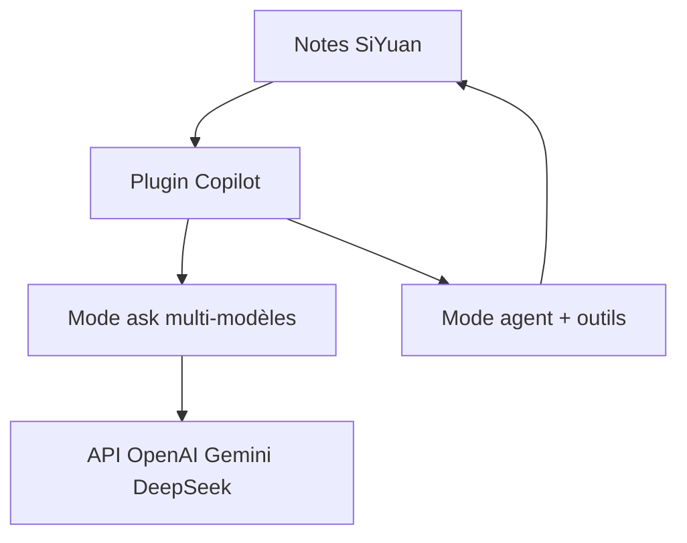

# Achuan-2/siyuan-plugin-copilot

> Plugin d'assistant IA pour l'application de notes SiYuan, avec réponses de plusieurs modèles et mode agent.

## Le problème
Poser une question à l'IA sur ses notes oblige à copier-coller entre plusieurs outils et modèles.

## Ce que ça fait vraiment
Dans SiYuan, on glisse des blocs, des pages ou des images vers l'IA. Le mode ask interroge plusieurs modèles à la fois pour choisir la meilleure réponse. Le mode agent peut chercher, modifier et créer des notes. Il propose aussi des préréglages, de la traduction rapide, la génération d'images et des skills personnalisés. Il fonctionne avec OpenAI, Gemini, DeepSeek, Volcengine et toute API compatible OpenAI.

## Comment c'est branché
Schéma simplifié d'après la fiche, sans diagramme fourni.



## Essayer
```bash
pnpm install
pnpm run dev
```

## Coût et pièges
Le plugin ne fournit pas d'IA : il faut ta propre clé d'API, avec la facture qui va avec. Le README est en chinois. Le mode agent peut modifier tes notes.

## Ce que ce n'est pas
Pas un produit indépendant : il ne marche que dans SiYuan. Le README commence par un sponsor, un service de génération d'images.

## Alternatives
Aucune alternative nommée dans le README ; il cite Cherry Studio comme source d'inspiration.

## Pour toi
À surveiller : seulement si tu prends déjà tes notes dans SiYuan ; sinon rien à en tirer pour un profil data, IA ou MLOps.

