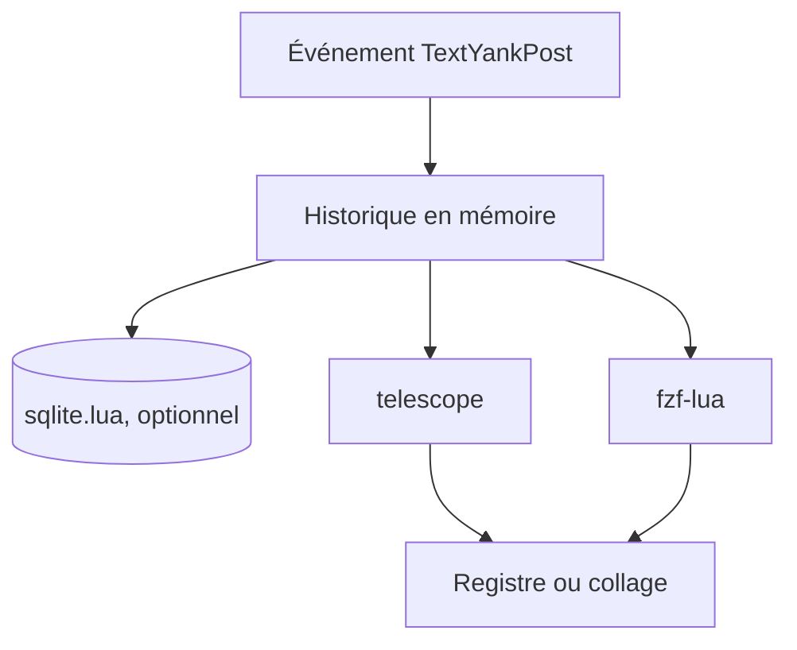

# AckslD/nvim-neoclip.lua

> Yank and macro history manager for Neovim, with search via telescope or fzf-lua.

## The problem
In Vim, a yank overwrites the previous one in the register: the old one is lost.

## What it actually does
Records every yank (1000 entries by default) and, if your Neovim allows it, every macro. You pick an entry via telescope or fzf-lua to fill a register, paste or replay. A history persistent across sessions is possible with `sqlite.lua`. An optional filter and custom actions are configurable.

## How it is wired


Simplified diagram based on the sheet, no diagram provided.

## Trying it
```bash
# Dans Neovim :
# require('neoclip').setup()
:Telescope neoclip
:Telescope macroscope
```

## Cost and gotchas
Free; requires telescope or fzf-lua, and sqlite.lua for persistence. No license declared, last push in February 2025.

## What it is not
Not a system clipboard manager: it only captures what is yanked inside Neovim. Macros require a recent nightly Neovim.

## Alternatives
No alternative named in the README (clipmenu is cited as an inspiration).

## For you
Ignore, unless you live in Neovim: editor comfort with no effect on data or MLOps work, and no license or recent update.
