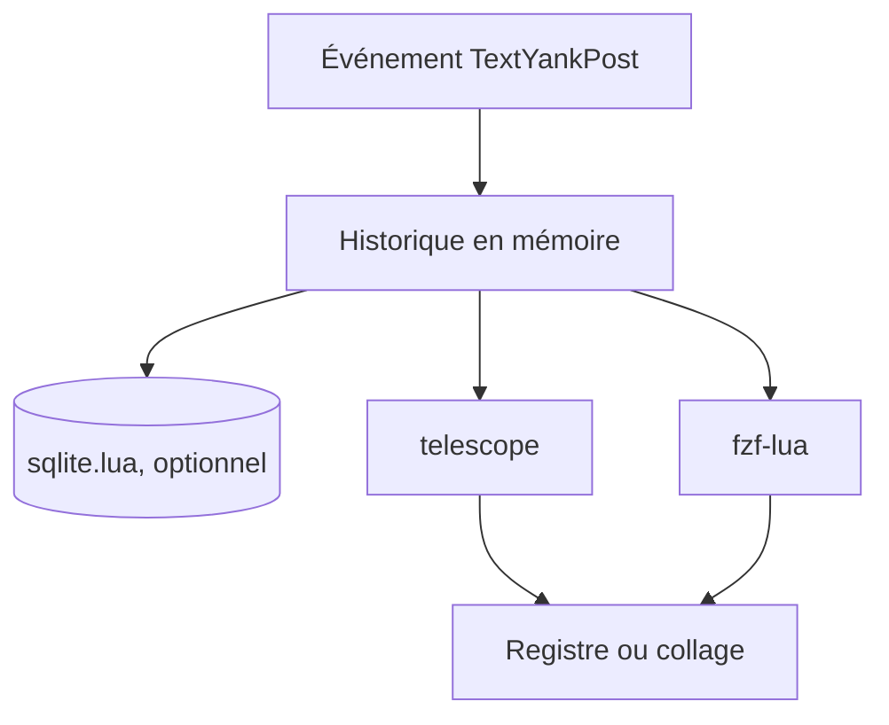

# AckslD/nvim-neoclip.lua

> Gestionnaire d'historique de copies et de macros pour Neovim, avec recherche par telescope ou fzf-lua.

## Le problème
Dans Vim, une copie écrase la précédente dans le registre : l'ancienne est perdue.

## Ce que ça fait vraiment
Enregistre chaque copie (1000 entrées par défaut) et, si le Neovim le permet, chaque macro. Tu choisis une entrée via telescope ou fzf-lua pour remplir un registre, coller ou rejouer. Un historique persistant entre sessions est possible avec `sqlite.lua`. Un filtre optionnel et des actions personnalisées sont configurables.

## Comment c'est branché


Schéma simplifié d'après la fiche, sans diagramme fourni.

## Essayer
```bash
# Dans Neovim :
# require('neoclip').setup()
:Telescope neoclip
:Telescope macroscope
```

## Coût et pièges
Gratuit ; il faut telescope ou fzf-lua, et sqlite.lua pour la persistance. Aucune licence déclarée, dernier push en février 2025.

## Ce que ce n'est pas
Pas un gestionnaire de presse-papiers système : il ne capte que ce qui est copié dans Neovim. Les macros exigent un Neovim nightly récent.

## Alternatives
Aucune alternative nommée dans le README (clipmenu est cité comme inspiration).

## Pour toi
À ignorer, sauf si tu vis dans Neovim : confort d'éditeur sans effet sur un travail data ou MLOps, et sans licence ni mise à jour récente.

