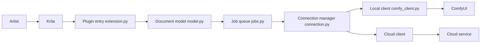

# Acly/krita-ai-diffusion

> Krita plugin for AI image generation and editing, backed by ComfyUI.

## The problem
Image generation tools are centered on AI parameters, not on a real painting/retouching workflow.

## What it actually does
Inpainting on a selection, live painting, upscaling, text-instruction editing models.
ControlNet (scribble, line art, pose, depth…), IP-Adapter, per-layer text regions, job queue and history.
Local ComfyUI backend installed automatically, existing/remote server, or cloud generation.
Supported models: Flux 2, Z-Image, SD 1.5, XL, Illustrious.

## How it is wired

## Trying it
No command: installation through Krita (Tools ▸ Scripts ▸ Import Python Plugin from File…, then Settings ‣ Dockers ‣ AI Image Generation).

## Cost and gotchas
Free locally with a capable GPU; cloud generation is paid (interstice.cloud). Krita 5.2.0+ required. GPL-3.0.

## What it is not
Not a library or an API: a graphical application plugin. Not a model.

## Alternatives
None named in the README.

## For you
Ignore for data/MLOps use: a very good creative tool, but no reusable building block for an ML pipeline.
