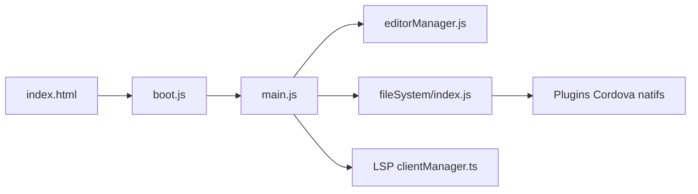

# Acode-Foundation/Acode

> Code editor for Android, with an Alpine terminal, SFTP and community plugins.

## The problem
Editing code on a phone or tablet with real tools (terminal, LSP, remote access).

## What it actually does
Cordova application: the JavaScript/TypeScript interface (CodeMirror) runs in a WebView and calls native plugins (file system, terminal, FTP/SFTP, local server, browser preview). Built-in Alpine terminal (proot), LSP servers, plugin manager. The architecture also shows in-app purchases and ads (AdMob).

## How it is wired

## Trying it
No command documented in the README: installation is done from the distribution platforms (links not reproduced).

## Cost and gotchas
Free to install; the code contains in-app purchase and advertising modules. The README does not mention it.

## What it is not
Not a full IDE: the Alpine terminal and the LSP are add-ons; the power depends on the device.

## Alternatives
No alternative named in the README.

## For you
Ignore: a mobile editor useful in a pinch, but with no place in a data/AI/MLOps workflow.
