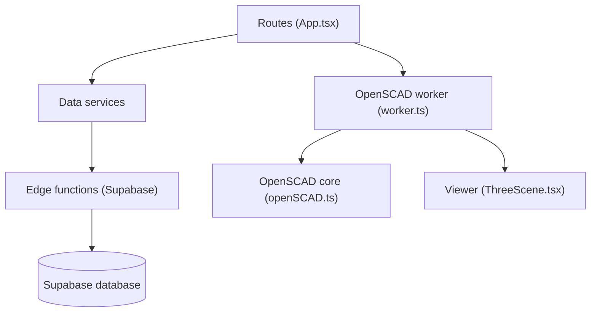

# Adam-CAD/CADAM

> Web application that turns a description into a parametric OpenSCAD 3D model.

## The problem
Modeling a parametric part requires mastering a CAD language such as OpenSCAD.

## What it actually does
You describe a part or provide an image; a Claude model generates parametric OpenSCAD code, executed in the browser by OpenSCAD WebAssembly, and previewed with Three.js. Sliders adjust dimensions without a new model call. Export as `.STL`, `.SCAD` or `.DXF`. The backend uses Supabase (database, auth, storage, functions).

## How it is wired


## Trying it
```bash
git clone https://github.com/Adam-CAD/CADAM.git
cd CADAM
npm install
npx supabase start
npx supabase functions serve --no-verify-jwt
npm run dev
```

## Cost and gotchas
Anthropic, OpenRouter, OpenAI, Google, FAL and Supabase keys must be provided, plus ngrok for local callbacks. Node ^20.19 or 22.12+. A billing service is provided for in the configuration.

## What it is not
Not an offline or independent tool: generation goes through external APIs. GPL-3.0 license: restrictive if you reuse the code.

## Alternatives
No alternative named in the README.

## For you
Ignore: CAD domain far from your data/AI profile, and heavy setup (Supabase, several keys).
