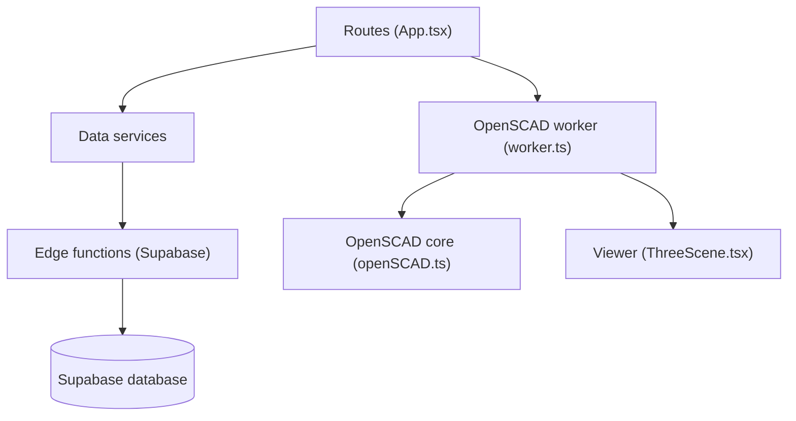

# Adam-CAD/CADAM

> Application web qui transforme une description en modèle 3D paramétrique OpenSCAD.

## Le problème
Modéliser une pièce paramétrique exige de maîtriser un langage CAD comme OpenSCAD.

## Ce que ça fait vraiment
Tu décris une pièce ou fournis une image ; un modèle Claude génère du code OpenSCAD paramétrique, exécuté dans le navigateur par OpenSCAD WebAssembly, et prévisualisé avec Three.js. Des curseurs ajustent les dimensions sans nouvel appel au modèle. Export en `.STL`, `.SCAD` ou `.DXF`. Le backend utilise Supabase (base, auth, stockage, fonctions).

## Comment c'est branché


## Essayer
```bash
git clone https://github.com/Adam-CAD/CADAM.git
cd CADAM
npm install
npx supabase start
npx supabase functions serve --no-verify-jwt
npm run dev
```

## Coût et pièges
Clés Anthropic, OpenRouter, OpenAI, Google, FAL et Supabase à fournir, plus ngrok pour les rappels locaux. Node ^20.19 ou 22.12+. Un service de facturation est prévu dans la configuration.

## Ce que ce n'est pas
Pas un outil hors ligne ni indépendant : la génération passe par des API externes. Licence GPL-3.0 : contraignante si tu reprends le code.

## Alternatives
Aucune alternative nommée dans le README.

## Pour toi
À ignorer : domaine CAO éloigné de ton profil data/IA, et mise en route lourde (Supabase, plusieurs clés).

