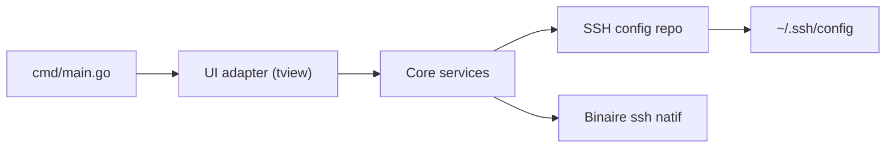

# Adembc/lazyssh

> Terminal SSH manager, keyboard-driven, built on `~/.ssh/config`.

## The problem
Remembering addresses, aliases and SSH options for a fleet of servers, and editing `~/.ssh/config` by hand.

## What it actually does
TUI (tview/tcell) that reads your SSH configuration: scrollable list, fuzzy search, tags, pinning, sorting, ping, tabbed add and edit, port forwarding. Connection goes through the system `ssh` binary. Atomic writes with backups (one original, ten rolling).

## How it is wired


## Trying it
```bash
brew install Adembc/homebrew-tap/lazyssh
git clone https://github.com/Adembc/lazyssh.git
cd lazyssh
make run
```

## Cost and gotchas
Free. It modifies your `~/.ssh/config`: the automatic backups limit the risk. File transfer and key deployment are still "coming soon".

## What it is not
Not a secrets manager: keys and passwords are neither stored nor transmitted. Not a fleet configuration tool.

## Alternatives
- lazydocker and k9s: inspiration, for Docker and Kubernetes.

## For you
Adopt if you juggle many servers or GPU machines: immediate time savings, limited risk thanks to the backups.
