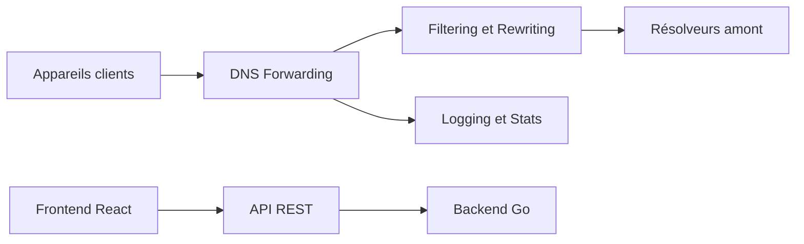

# AdguardTeam/AdGuardHome

> Self-hosted DNS server that blocks ads and trackers for all the devices on a network.

## The problem
Blocking ads and trackers device by device is impossible on TVs or connected objects, where nothing can be installed.

## What it actually does
It acts as a DNS server and redirects tracking domains to a "black hole". The Go backend handles DNS redirection, filtering and rewriting, a built-in DHCP, statistics and logs, and encryption (DoH, DoT, upstream DNSCrypt). A React interface serves as administration through a REST API. It cannot block ads that share the domain of the content (YouTube, for example).

## How it is wired


## Trying it
```bash
curl -s -S -L https://raw.githubusercontent.com/AdguardTeam/AdGuardHome/master/scripts/install.sh | sh -s -- -v
git clone https://github.com/AdguardTeam/AdGuardHome
cd AdGuardHome
make
```

## Cost and gotchas
Free. It needs an always-on machine and devices configured to use it. Building requires Go 1.25 and Node 24.10. The README states that no usage statistics are collected.

## What it is not
It is not a complete content blocker: DNS-based blocking remains limited. GPL-3.0 license: copyleft, to be integrated with caution into a closed product.

## Alternatives
- Pi-Hole: compared in the README; AdGuard Home wins on interface HTTPS, native DoH and cross-platform support.

## For you
Worth watching: useful for a personal or lab network, with no direct link to the data/AI core; note the GPL-3.0 before embedding it.
