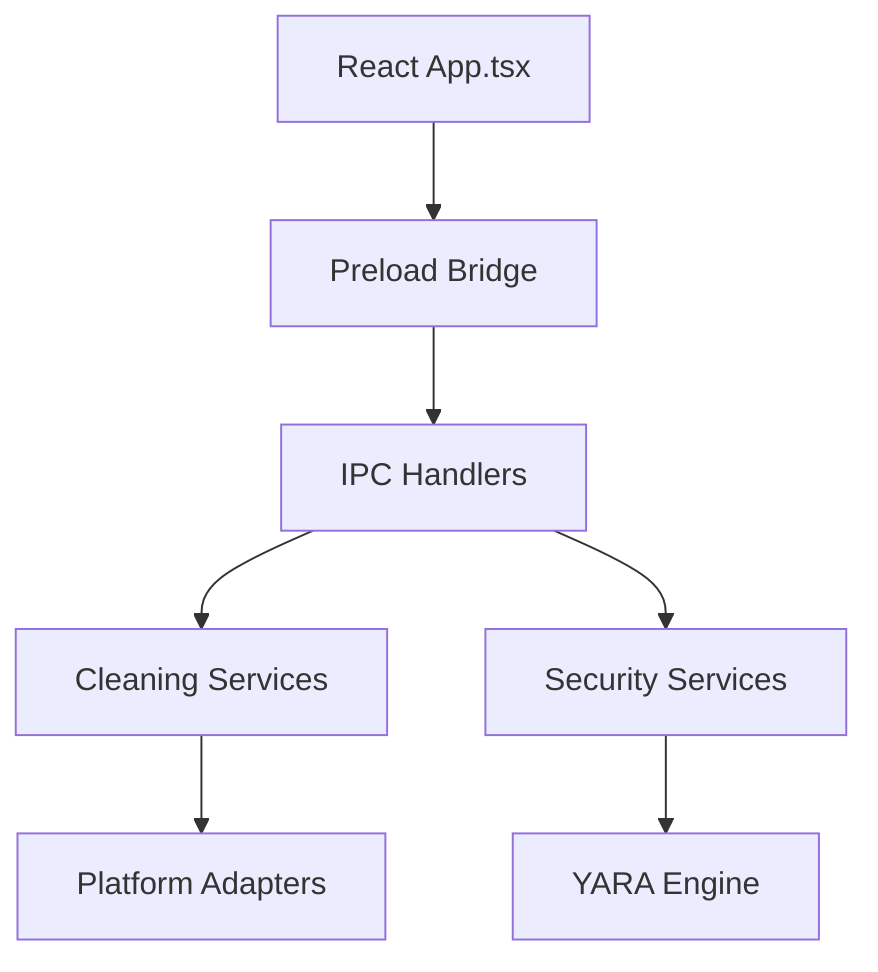

# AdventDevInc/kudu

> Electron system cleaner and security scanner for Windows, macOS and Linux.

## The problem
PC cleaners are often full of ads, bundled software and paid options.

## What it actually does
Kudu cleans system, browser, application and game caches, manages the registry and startup items, analyzes the disk, hunts for malware (YARA engine), applies privacy settings, updates software, monitors performance and schedules scans. It also has a command-line interface, 31 languages and a "cloud" agent whose role is not detailed.

## How it is wired


## Trying it
```bash
# Aucune commande dans le README : téléchargement des versions publiées sur GitHub Releases.
```

## Cost and gotchas
Free. By design the software deletes files; the README disclaims all responsibility for data loss. Portable versions are updated by hand. Repository created in March 2026, so it is young.

## What it is not
It is not a proven antivirus: the malware scanner relies on YARA rules, with no effectiveness measurement provided. The "everything is local" promise is the README's.

## Alternatives
No alternative named in the README.

## For you
Ignore: a recent desktop utility, unrelated to data or AI.
