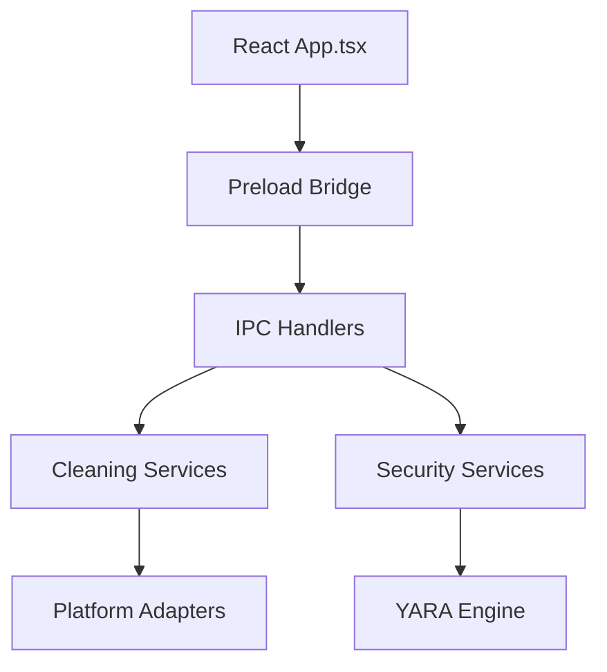

# AdventDevInc/kudu

> Nettoyeur de système et scanner de sécurité Electron pour Windows, macOS et Linux.

## Le problème
Les nettoyeurs de poste sont souvent bourrés de publicités, de logiciels additionnels et d'options payantes.

## Ce que ça fait vraiment
Kudu nettoie les caches du système, des navigateurs, des applications et des jeux, gère le registre et le démarrage, analyse le disque, cherche des logiciels malveillants (moteur YARA), applique des réglages de confidentialité, met à jour des logiciels, surveille les performances et planifie des analyses. Il a aussi une interface en ligne de commande, 31 langues et un agent « cloud » dont le rôle n'est pas détaillé.

## Comment c'est branché


## Essayer
```bash
# Aucune commande dans le README : téléchargement des versions publiées sur GitHub Releases.
```

## Coût et pièges
Gratuit. Le logiciel supprime des fichiers par conception ; le README dégage toute responsabilité en cas de perte de données. Les versions portables se mettent à jour à la main. Dépôt créé en mars 2026, donc jeune.

## Ce que ce n'est pas
Ce n'est pas un antivirus éprouvé : le scanner de logiciels malveillants s'appuie sur des règles YARA, sans mesure d'efficacité fournie. La promesse « tout est local » est celle du README.

## Alternatives
Aucune alternative nommée dans le README.

## Pour toi
À ignorer : utilitaire de poste de travail récent, sans lien avec la data ou l'IA.

