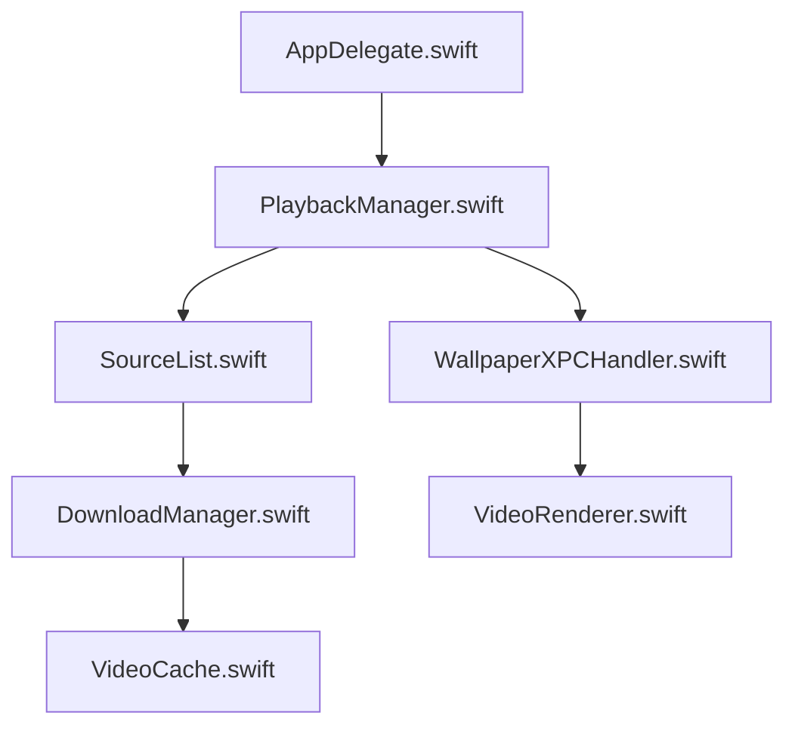

# AerialScreensaver/Aerial

> macOS screensaver reusing the Apple TV videos, with overlays and animated wallpaper.

## The problem
The old `.saver` API is obsolete on recent macOS versions and no longer works well.

## What it actually does
Application and wallpaper extension that downloads and caches videos, renders them with a dedicated engine, and overlays information (weather, time). The extension receives its commands via XPC. The README notes that it uses a private Apple API.

## How it is wired


## Trying it
```bash
git clone https://github.com/AerialScreensaver/Aerial.git
cd Aerial
open Aerial.xcodeproj
```

## Cost and gotchas
Free. Requires macOS 15 and Xcode 16. Weather requires your own OpenWeather key, absent from the repository. Swift is not in the prerequisites list.

## What it is not
Not a cross-platform tool nor data software: it only runs on macOS.

## Alternatives
No alternative named in the README.

## For you
Ignore: macOS screensaver, no link with data, AI or MLOps work.
