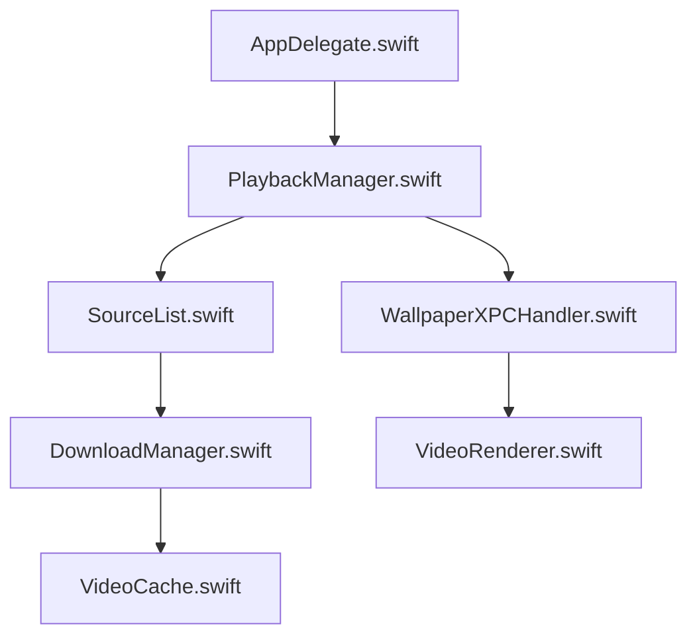

# AerialScreensaver/Aerial

> Économiseur d'écran macOS reprenant les vidéos Apple TV, avec incrustations et fond d'écran animé.

## Le problème
L'ancienne API `.saver` est obsolète sous les macOS récents et ne fonctionne plus bien.

## Ce que ça fait vraiment
Application et extension de fond d'écran qui télécharge et met en cache des vidéos, les rend avec un moteur dédié, et superpose des incrustations (météo, heure). L'extension reçoit ses ordres par XPC. Le README signale qu'elle utilise une API privée d'Apple.

## Comment c'est branché


## Essayer
```bash
git clone https://github.com/AerialScreensaver/Aerial.git
cd Aerial
open Aerial.xcodeproj
```

## Coût et pièges
Gratuit. Il faut macOS 15 et Xcode 16. La météo exige ta propre clé OpenWeather, absente du dépôt. Swift n'existe pas dans la liste des prérequis.

## Ce que ce n'est pas
Pas un outil multiplateforme ni un logiciel data : il ne tourne que sous macOS.

## Alternatives
Aucune alternative nommée dans le README.

## Pour toi
À ignorer : économiseur d'écran macOS, aucun lien avec un travail data, IA ou MLOps.

