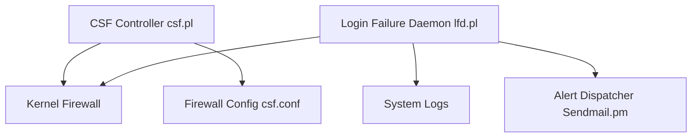

# Aetherinox/csf-firewall

> ConfigServer Firewall (CSF) suite for Linux servers, abandoned by its original publisher.

## The problem
Configuring iptables or nftables and monitoring login failures by hand is tedious and risky.

## What it actually does
CSF is a stateful packet inspection firewall, a front end for iptables or nftables. The LFD daemon reads the logs, detects brute-force attacks and blocks the sources. It sends alerts, manages blocklists (ipset) and country blocking. It integrates with cPanel, DirectAdmin, CWP, VestaCP, CyberPanel and InterWorx. Forked since August 2025.

## How it is wired


## Trying it
```bash
wget https://download.configserver.dev/csf.zip
unzip -oq "csf.zip" -d "csf"
cd csf
sudo perl csf/csftest.pl
sudo sh install.sh
sudo csf --enable
sudo systemctl start csf
sudo systemctl start lfd
```

## Cost and gotchas
Free. Requires Perl and root access; the `TESTING` mode must be disabled in `/etc/csf/csf.conf`. The README warns about fake repositories selling a "commercial" version. A wrong rule can lock you out of your server.

## What it is not
Not an offensive tool: it is a defense. Not an enterprise network firewall. An unofficial fork of the original product.

## Alternatives
No alternative named in the README.

## For you
Ignore: useful for securing a web server, but outside your data / AI scope, unless you administer your own machine.
