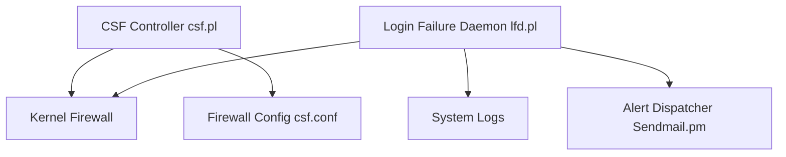

# Aetherinox/csf-firewall

> Suite du pare-feu ConfigServer (CSF) pour serveurs Linux, abandonné par son éditeur d'origine.

## Le problème
Configurer iptables ou nftables et surveiller les échecs de connexion à la main est fastidieux et risqué.

## Ce que ça fait vraiment
CSF est un pare-feu à inspection d'état, frontal d'iptables ou nftables. Le démon LFD lit les journaux, détecte les attaques par force brute et bloque les sources. Il envoie des alertes, gère des listes de blocage (ipset) et un blocage par pays. Il s'intègre à cPanel, DirectAdmin, CWP, VestaCP, CyberPanel et InterWorx. Fork depuis août 2025.

## Comment c'est branché


## Essayer
```bash
wget https://download.configserver.dev/csf.zip
unzip -oq "csf.zip" -d "csf"
cd csf
sudo perl csf/csftest.pl
sudo sh install.sh
sudo csf --enable
sudo systemctl start csf
sudo systemctl start lfd
```

## Coût et pièges
Gratuit. Il faut Perl et un accès root ; mode `TESTING` à désactiver dans `/etc/csf/csf.conf`. Le README met en garde contre de faux dépôts vendant une version « commerciale ». Une règle erronée peut te couper de ton serveur.

## Ce que ce n'est pas
Pas un outil offensif : c'est une défense. Pas un pare-feu réseau d'entreprise. Un fork non officiel du produit d'origine.

## Alternatives
Aucune alternative nommée dans le README.

## Pour toi
À ignorer : utile pour sécuriser un serveur web, mais hors de ton périmètre data / IA, sauf si tu administres ta propre machine.

