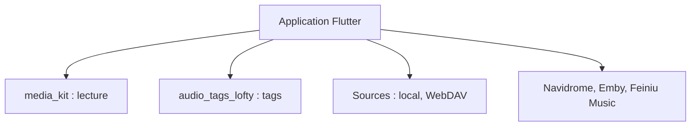

# AfalpHy/sylvakru

> Cross-platform music player (Flutter) for local libraries and self-hosted media servers.

## The problem
Mainstream music players do not easily connect to Navidrome, Emby or WebDAV from a single cross-platform client.

## What it actually does
Flutter application for Android, iOS, Windows, Linux and macOS. Supported sources: local files, WebDAV, Navidrome, Emby, Feiniu Music. Playback relies on media_kit (mpv/FFmpeg) and tags on audio_tags_lofty. An iOS version exists on the App Store according to the README.

## How it is wired
Simplified diagram based on the sheet, no diagram provided.



## Trying it
```bash
git clone https://github.com/AfalpHy/sylvakru.git
cd sylvakru
flutter doctor -v
flutter run
flutter build linux
```

## Cost and gotchas
Free. Building requires Flutter and, on Ubuntu/Debian, system packages (clang, cmake, libgtk-3-dev, libmpv-dev…).

## What it is not
Not a streaming service: it plays your own files or your server. Android's exclusive USB mode is maintained in a separate fork.

## Alternatives
No alternative named in the README.

## For you
Ignore: a music player has no link with data / AI / MLOps work.
