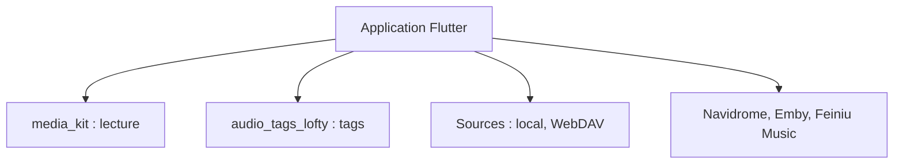

# AfalpHy/sylvakru

> Lecteur de musique multiplateforme (Flutter) pour bibliothèques locales et serveurs de médias auto-hébergés.

## Le problème
Les lecteurs musicaux grand public ne se branchent pas facilement sur Navidrome, Emby ou WebDAV depuis un seul client multiplateforme.

## Ce que ça fait vraiment
Application Flutter pour Android, iOS, Windows, Linux et macOS. Sources prises en charge : fichiers locaux, WebDAV, Navidrome, Emby, Feiniu Music. La lecture repose sur media_kit (mpv/FFmpeg) et les tags sur audio_tags_lofty. Une version iOS existe sur l'App Store selon le README.

## Comment c'est branché
Schéma simplifié d'après la fiche, sans diagramme fourni.



## Essayer
```bash
git clone https://github.com/AfalpHy/sylvakru.git
cd sylvakru
flutter doctor -v
flutter run
flutter build linux
```

## Coût et pièges
Gratuit. La compilation exige Flutter et, sous Ubuntu/Debian, des paquets système (clang, cmake, libgtk-3-dev, libmpv-dev…).

## Ce que ce n'est pas
Pas un service de streaming : il lit tes propres fichiers ou ton serveur. Le mode USB exclusif Android est maintenu dans un fork à part.

## Alternatives
Aucune alternative nommée dans le README.

## Pour toi
Ignorer : un lecteur de musique n'a pas de lien avec un travail data / IA / MLOps.

