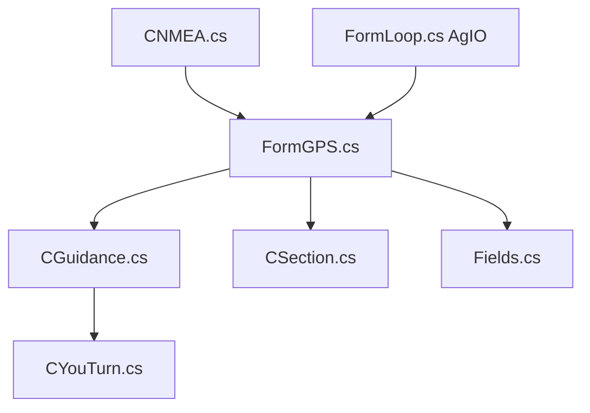

# AgOpenGPS-Official/AgOpenGPS

> Precision guidance and mapping software for tractors, in maintenance mode, with section control.

## The problem
Guiding a tractor across a field and avoiding spreading overlaps requires positioning software.

## What it actually does
Reads NMEA sentences from a GPS, records and maps the position. Produces pure-pursuit steering angles for AB lines, AB curves and contours, handles automatic U-turns and up to 16 sections of individual width, or 64 of equal width. AgIO serves as the communication relay. WinForms development has been frozen since April 2026: fixes only, the future is in Avalonia.

## How it is wired


## Trying it
```bash
dotnet publish SourceCode/AgOpenGPS.sln
# Installation : décompresser la release, lancer AgOpenGPS.exe
```

## Cost and gotchas
Free, but the hardware (GPS receiver, boards and firmware from the PCB repository) is at your expense. Built with Visual Studio; Windows in practice.

## What it is not
Not a yield-mapping or remote-sensing application. No new features on this version.

## Alternatives
No alternative named in the README.

## For you
Ignore: embedded agriculture in frozen .NET, with no direct link to data or MLOps.
