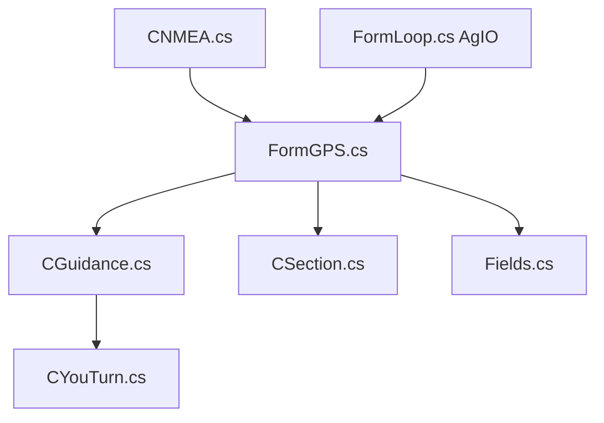

# AgOpenGPS-Official/AgOpenGPS

> Logiciel de guidage et de cartographie de précision pour tracteurs, en mode maintenance, avec contrôle de sections.

## Le problème
Guider un tracteur sur un champ et éviter les recouvrements d'épandage demande un logiciel de positionnement.

## Ce que ça fait vraiment
Lit les trames NMEA d'un GPS, enregistre et cartographie la position. Produit des angles de direction par poursuite pure pour lignes AB, courbes AB et contours, gère les demi-tours automatiques et jusqu'à 16 sections de largeur propre, ou 64 de largeur égale. AgIO sert de relais de communication. Le développement WinForms est figé depuis avril 2026 : correctifs seulement, la suite est en Avalonia.

## Comment c'est branché


## Essayer
```bash
dotnet publish SourceCode/AgOpenGPS.sln
# Installation : décompresser la release, lancer AgOpenGPS.exe
```

## Coût et pièges
Gratuit, mais le matériel (récepteur GPS, cartes et micrologiciels du dépôt PCB) est à ta charge. Se construit sous Visual Studio ; Windows en pratique.

## Ce que ce n'est pas
Pas une application de cartographie de rendement ni de télédétection. Plus de nouvelles fonctions sur cette version.

## Alternatives
Aucune alternative nommée dans le README.

## Pour toi
Ignorer : agriculture embarquée en .NET figé, sans lien direct avec la data ou le MLOps.

