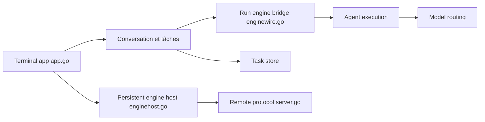

# Agent-Field/CodeAF

> Terminal coding harness (Go) that splits work into tasks across several projects, using open models.

## The problem
Running several coding agents means one terminal per repository, with you in the middle to plan, test and merge.

## What it actually does
A single window lists all your projects. You describe the work: it is split into tasks, each in its own copy of the repository and on its own branch, then tested. What passes its check lands on your branch (never `main`). Four model "seats" are chosen per task, with a spending cap. Headless mode (`codeaf do`) and remote session over SSH. The DeepSWE ranking is claimed by the authors.

## How it is wired


## Trying it
```bash
curl -fsSL https://agentfield.ai/get/codeaf | bash
codeaf
codeaf do "bump every dependency whose changelog is worth reading" --timeout 30m --json
codeaf chat --host devbox
```

## Cost and gotchas
API key for OpenRouter, DeepSeek, GLM, Kimi… or a ChatGPT subscription via Codex; Ollama needs no key. Per-task cap of $5 by default. Telemetry and Model Pool are on by default (`CODEAF_TELEMETRY=off`, `DO_NOT_TRACK=1`).

## What it is not
Not an editor copilot. The README announces an early preview with rough edges. Relay without SSH is not active yet. `review` and `sec` read the code without testing it; the absence of a finding proves nothing.

## Alternatives
- Claude Code: single-session coding agent, already very widespread.
- Codex, OpenCode, Kilo: harnesses compared in the README benchmark.

## For you
Worth watching: the idea of multi-project control with per-task model choice is useful, but the project is young and telemetry is on by default; try it on a non-sensitive repository.
