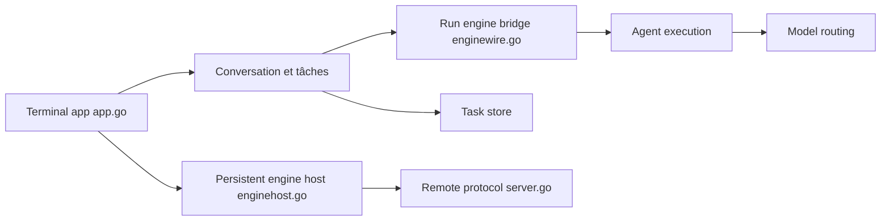

# Agent-Field/CodeAF

> Harnais de code en terminal (Go) qui répartit le travail en tâches sur plusieurs projets, avec modèles ouverts.

## Le problème
Plusieurs agents de code, c'est un terminal par dépôt, et vous au milieu pour planifier, tester et fusionner.

## Ce que ça fait vraiment
Une seule fenêtre liste tous les projets. Vous décrivez le travail : il est découpé en tâches, chacune dans sa copie du dépôt et sur sa branche, puis testé. Ce qui passe son contrôle arrive sur votre branche (jamais `main`). Quatre « sièges » de modèles sont choisis par tâche, avec plafond de dépense. Mode headless (`codeaf do`) et session déportée par SSH. Le classement DeepSWE est revendiqué par les auteurs.

## Comment c'est branché


## Essayer
```bash
curl -fsSL https://agentfield.ai/get/codeaf | bash
codeaf
codeaf do "bump every dependency whose changelog is worth reading" --timeout 30m --json
codeaf chat --host devbox
```

## Coût et pièges
Clé d'API OpenRouter, DeepSeek, GLM, Kimi… ou abonnement ChatGPT via Codex ; Ollama sans clé. Plafond par tâche de 5 $ par défaut. Télémétrie et Model Pool actifs par défaut (`CODEAF_TELEMETRY=off`, `DO_NOT_TRACK=1`).

## Ce que ce n'est pas
Pas un copilote d'éditeur. Le README annonce un aperçu précoce avec des aspérités. Le relais sans SSH n'est pas encore actif. `review` et `sec` lisent le code sans le tester ; l'absence de résultat ne prouve rien.

## Alternatives
- Claude Code : agent de code mono-session, déjà très répandu.
- Codex, OpenCode, Kilo : harnais comparés dans le benchmark du README.

## Pour toi
À surveiller : l'idée de pilotage multi-projets avec choix de modèle par tâche est utile, mais le projet est jeune et la télémétrie est active par défaut ; teste-le sur un dépôt non sensible.

