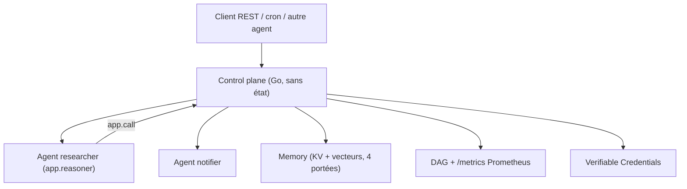

# Agent-Field/agentfield

> Control plane that exposes agent functions as a REST API and orchestrates their fan-out.

## The problem
As soon as a second service needs to call your agent, you start hand-writing queues, retries,
service discovery and tracing.

## What it actually does
You write Python, Go or TypeScript functions decorated with `@app.reasoner()` (AI judgment) or
`@app.skill()` (deterministic code); `app.run()` exposes them as `POST /api/v1/execute/{agent}.{func}`.
`app.call()` routes to other agents through the control plane, so a recursion
becomes a distributed fan-out; `app.pause()` suspends for human approval;
`app.memory` offers key-value storage and vector search across four scopes without Redis.
Each agent gets a cryptographic identity (W3C DID + Ed25519) and each execution a
credential that can be verified offline.

## How it is wired


## Trying it
```bash
curl -fsSL https://agentfield.ai/install.sh | bash
af init my-agent --defaults
af server          # Terminal 1 → Dashboard at http://localhost:8080
python main.py     # Terminal 2 → Agent auto-registers
docker run -p 8080:8080 agentfield/control-plane:latest
af install https://github.com/Agent-Field/sec-af
```

## Cost and gotchas
The control plane is free but every LLM call goes through your own key (LiteLLM, 100+
models). The macOS installer registers a launchd service and a menu-bar icon;
a plain `kill` is treated as a crash and restarts it. Installation and
lifecycle telemetry is on by default, to be turned off with `AGENTFIELD_TELEMETRY_ENABLED=false`. Routing
overhead is stated as 100-200 ms per hop between agents.

## What it is not
It is not a framework for writing agents: LangGraph or CrewAI can run inside a
reasoner. Nor is it a simple HTTP server — it is infrastructure with identity, policies and audit, hence something you have to operate.

## Alternatives
- Temporal or Airflow: workflow engines, cited as covering async and retries but
  not agent logic.
- n8n or Zapier: visual builders, ready-made REST APIs but no agent mesh.
- LangChain, CrewAI, PydanticAI, OpenAI Agents SDK: for writing the agent, not for operating it.

## For you
Relevant the day your agents must be called by the rest of the information system, not before.
