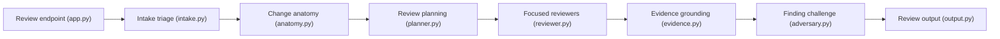

# Agent-Field/pr-af

> Multi-pass, agent-based pull request reviewer, with evidence drawn from the code, on the AgentField platform.

## The problem
Superficial diff summaries miss bugs and produce unfounded comments.

## What it actually does
Each PR is triaged, mapped, then review "dimensions" are generated and handed to specialized agents. Findings are checked against the code (AST extraction), subjected to falsifiability gates, grouped to detect compound risks, then published as GitHub comments. The README claims a recall of 0.706 on Martian Code-Review-Bench with GLM-5.2, measured by the authors.

## How it is wired


## Trying it
```bash
af install https://github.com/Agent-Field/pr-af
af run pr-af
af call pr-af.review --in '{"pr_url": "https://github.com/owner/repo/pull/123"}'
```

## Cost and gotchas
`OPENROUTER_API_KEY` and `GH_TOKEN` required; per-run cap of $2 and 3,600 s by default. A review typically takes 35 to 50 minutes. No license declared in the catalog.

## What it is not
Not a fast interactive review: the README recommends Claude Code locally and PR-AF as the last gate in CI. The benchmark results are not independent.

## Alternatives
- Claude Code CLI: for a fast development loop.
- CodeRabbit or Codex (SaaS): more polished GitHub interface, review in a few minutes.

## For you
Watch as a CI review gate with capped cost; the lack of a license blocks adoption until it is clarified.
