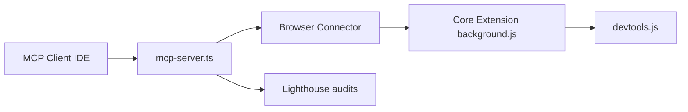

# AgentDeskAI/browser-tools-mcp

> MCP server and Chrome extension that give a coding agent your browser session.

## The problem
CDP-based MCPs drive a blank browser: you cannot debug the app you are already logged into.

## What it actually does
A DevTools extension captures the console, network, screenshots and the selected element.
MCP tools (`getConsoleErrors`, `getNetworkLogs`, `takeScreenshot`…) and Lighthouse audits (performance, accessibility, SEO).
Each tab is tracked separately; large volumes go through MCP resources (HAR, reports).
Listens on loopback only, authentication token, credentials redacted.

## How it is wired


## Trying it
```bash
npx @agentdeskai/browser-tools-mcp --doctor
npx @agentdeskai/browser-tools-server --verbose
```

## Cost and gotchas
Free; requires Node 22.19+. Version 1.2.x has a critical vulnerability: update.

## What it is not
Not a test automation tool. Firefox is not verified, and the network is only captured once DevTools is open.

## Alternatives
- Chrome DevTools MCP: fresh automated browser, for testing.
- Playwright MCP: same logic, test-oriented.

## For you
Worth watching: useful if you debug front ends with Claude Code, but insist on version 2.x because of the 1.x flaw.
