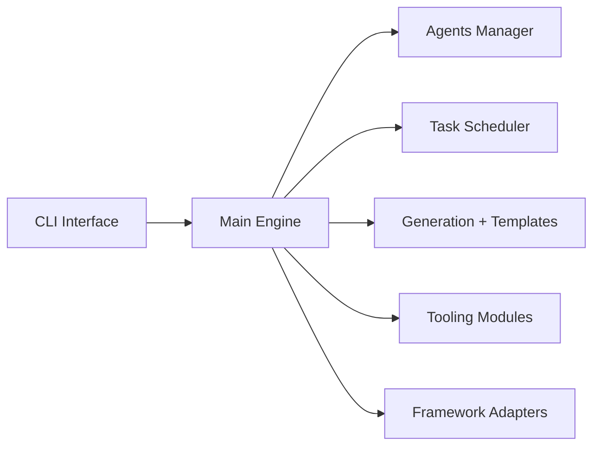

# AgentOps-AI/AgentStack

> Command-line scaffolding generator for AI agent projects, create-react-app style.

## The problem
Starting an agent project with CrewAI, LangGraph or other frameworks requires repetitive configuration.

## What it actually does
`agentstack init` creates the folder tree, `agentstack generate agent/task` produces the code, `agentstack tools add` plugs in tools; agents and tasks are described in YAML. Frameworks and templates are modules in the package. Production is not yet covered ("soon").

## How it is wired


## Trying it
```bash
uv pip install agentstack
agentstack init <project_name>
agentstack generate agent/task <name>
agentstack tools add
agentstack run
```

## Cost and gotchas
Model keys at your expense. The architecture file contains telemetry.py: the collection is not described in the README. Python 3.10 or higher.

## What it is not
Not a low-code solution: you need to know the chosen framework. Not an agent engine itself.

## Alternatives
- No alternative named in the README.

## For you
Worth watching: saves time launching an agent prototype, but the abstraction and the lack of a path to production limit its interest for serious use.
