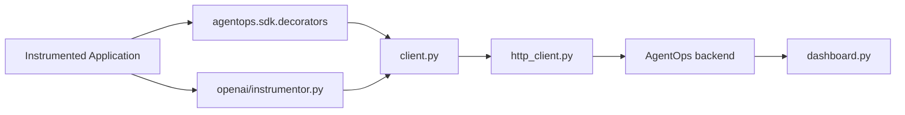

# AgentOps-AI/agentops

> Python observability SDK for LLM agents: traces, costs and session replay.

## The problem
A multi-step agent fails without anyone knowing which LLM call, which tool or which expense went wrong.

## What it actually does
`agentops.init()` automatically instruments LLM calls (OpenTelemetry) and sends them to the backend.
`@session`, `@agent`, `@operation`, `@workflow` decorators to structure the spans.
Integrations with CrewAI, AG2, LangChain, LlamaIndex, OpenAI Agents, Anthropic, Mistral, LiteLLM…
Dashboard: execution graphs, replay, cost; self-hostable application (`app/` folder).

## How it is wired


## Trying it
```bash
pip install agentops
pip install 'crewai[agentops]'
pip install agentops[langchain]
```

## Cost and gotchas
An AgentOps key is required (account); prompts and responses are sent to the backend unless self-hosted.

## What it is not
Not an agent framework: it observes other people's. The README examples mix old APIs (`end_session`) and new ones.

## Alternatives
No alternative named in the README.

## For you
Worth watching: useful for tracing CrewAI or LangChain agents, but sending your traces to a SaaS is debatable; self-hosting is the route to test.
