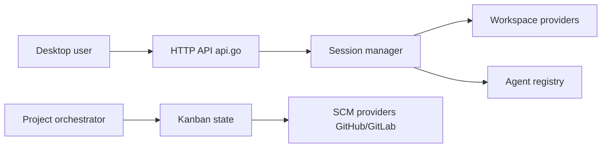

# AgentWrapper/agent-orchestrator

> Desktop application to run several coding agents in parallel and follow their PRs on a Kanban board.

## The problem
Several agents in parallel create branch collisions and scattered terminals, with no shared view of review and CI.

## What it actually does
Each task gets an agent, a branch and a Git worktree. A project orchestrator splits plans and delegates to workers. A local daemon tracks activity, PRs, CI and reviews, and places each card on the Kanban (Working, Needs you, In review, Ready to merge).

## How it is wired


## Trying it
```bash
git clone https://github.com/Untrivial-ai/agent-orchestrator.git
cd agent-orchestrator
```
No other installation command in the README: the application is downloaded from the Releases page.

## Cost and gotchas
You bring the agents and their subscriptions or keys. Telemetry is on: the README mentions sending the project's GitHub owner and the connected GitHub username, with no separate setting, except by turning off all telemetry.

## What it is not
Not a coding agent itself, only a supervisor. The diagram covers only part of the code (source not sampled). The license is not declared in the catalog.

## Alternatives
No alternative named in the README.

## For you
Worth watching: interesting if you run several agents on one repository, but the named telemetry and the absence of a known license call for a check.
