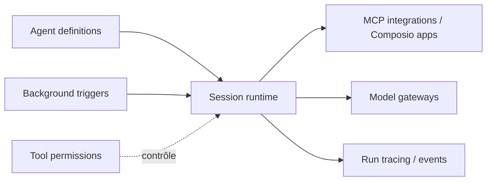

# Agenta-AI/agenta

> Open-source workspace to build, share and run agents, in chat or as background tasks.

## The problem
Building useful agents, sharing them across a team, triggering them on events and understanding their failures requires assembling several building blocks.

## What it actually does
You describe the work to an agent in chat, connect apps (MCP, or more than 1,000 apps via Composio) and set permissions per tool. Agents run interactively or in the background (schedule, event). Every run is traced with tokens and estimated cost, and the configuration is versioned. Supported harnesses: Claude Code, Pi, Codex. The runtime wiring below comes from the README, not from inspecting the code.

## How it is wired


## Trying it
```bash
# Auto-hébergement, selon le README (à coller dans ton agent) :
npx skills add Agenta-AI/agenta-skills
# puis : « Help me self-host Agenta with its repository. »
```

## Cost and gotchas
A cloud version exists; self-hosting lets you use an existing Claude or ChatGPT subscription instead of API billing. 349 open issues.

## What it is not
Not a fixed-step workflow builder (the README distinguishes it from n8n, Zapier). It does not replace the coding agent: it adds the workspace around it.

## Alternatives
- n8n / Activepieces / Zapier: for predictable processes with defined steps.
- Claude Cowork: a workspace tied to Claude, not open.

## For you
Worth watching: useful if you want traces, versions and permissions around team agents, but the license needs to be checked before any professional use.
