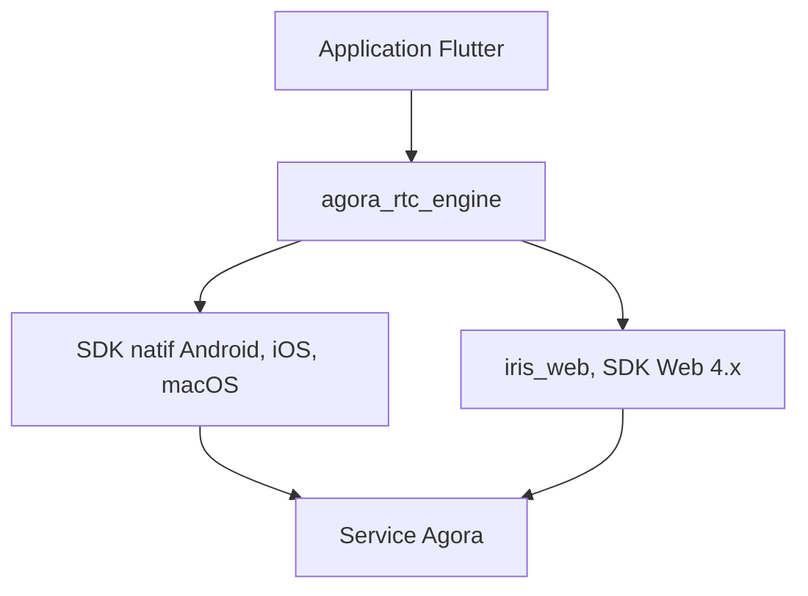

# AgoraIO-Extensions/Agora-Flutter-SDK

> Flutter plugin that wraps the Agora video SDK to add real-time voice and video calls.

## The problem
Integrating real-time communication into a Flutter app requires native bindings for each platform.

## What it actually does
The agora_rtc_engine package exposes the native Agora 4.x SDK to Flutter on Android, iOS and macOS, plus Windows and an alpha web version (via iris_web). It also lets you create an engine from the native handle to process raw audio and video data.

## How it is wired
Simplified diagram based on the sheet, no diagram provided.

## Trying it
`agora_rtc_engine` dependency in pubspec.yaml; examples in the example folder. No more specific command in the README.

## Cost and gotchas
Requires camera and microphone permissions. The Agora service is a SaaS: an account is required, and the pricing grid is not in the README. The main branch breaks compatibility with the 5.x series.

## What it is not
Not a standalone communication engine: it depends on Agora's infrastructure. The web API is not equivalent to the native APIs.

## Alternatives
No alternative cited in the README.

## For you
Ignore: binding to a third-party video-conferencing service, unrelated to data or MLOps work.
