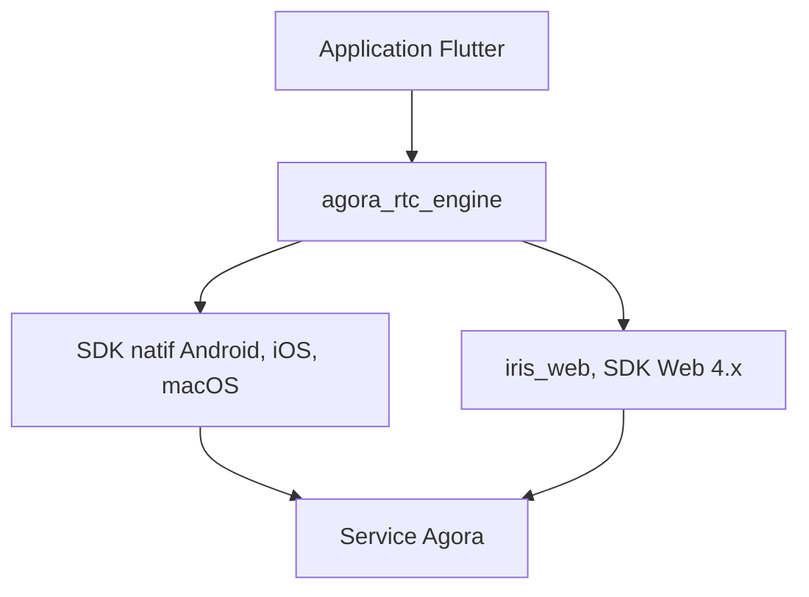

# AgoraIO-Extensions/Agora-Flutter-SDK

> Plugin Flutter qui enveloppe le SDK vidéo Agora pour intégrer appels vocaux et vidéo temps réel.

## Le problème
Intégrer de la communication temps réel dans une app Flutter demande des liaisons natives par plateforme.

## Ce que ça fait vraiment
Le paquet agora_rtc_engine expose le SDK natif Agora 4.x à Flutter sur Android, iOS et macOS, plus Windows et une version web en alpha (via iris_web). Il permet aussi de créer un moteur à partir du handle natif pour traiter les données audio et vidéo brutes.

## Comment c'est branché
Schéma simplifié d'après la fiche, sans diagramme fourni.

## Essayer
Dépendance `agora_rtc_engine` dans pubspec.yaml ; exemples dans le dossier example. Pas de commande plus précise dans le README.

## Coût et pièges
Demande des autorisations caméra et micro. Le service Agora est un SaaS : un compte est requis, et la grille tarifaire n'est pas dans le README. La branche main casse la compatibilité avec la série 5.x.

## Ce que ce n'est pas
Pas un moteur de communication autonome : il dépend de l'infrastructure Agora. L'API web n'est pas équivalente aux API natives.

## Alternatives
Aucune alternative citée dans le README.

## Pour toi
Ignorer : liaison vers un service tiers de visioconférence, sans lien avec un travail data ou MLOps.

