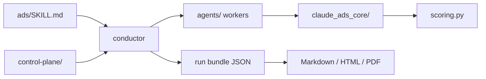

# AgriciDaniel/claude-ads

> Set of Claude skills to audit and run ad accounts, read-only by default.

## The problem
Paid media audits are done by hand, with no trace of sources or dates, and an agent that writes directly to an account can break campaigns.

## What it actually does
Turns authorized exports or account reads into dated audits, plans, creative briefs, experiments and reports.
Twelve platforms (Google, Meta, YouTube, LinkedIn, TikTok, Microsoft, Reddit, Snapchat, X, Apple, Amazon, Pinterest), each with its own skill and worker.
The canonical output is versioned JSON; Markdown, HTML and PDF are only renderings of it.
Any write requires a tested capability, explicit IDs, a before/after diff, approval, an idempotency key and rollback.

## How it is wired


## Trying it
```bash
git clone https://github.com/AgriciDaniel/claude-ads.git
cd claude-ads
bash install.sh --source=local
python -m claude_ads_core --version
```

## Cost and gotchas
Access to the ad platforms is at your expense; Playwright for browser capture, WeasyPrint and Pango for PDF. CPython 3.11 or 3.12 only.

## What it is not
Not a tool that drives campaigns: writes stay disabled until the gates are passed, and permanent deletion does not exist in v2. Not a data source: you need exports or accesses already obtained. Coverage of 60 to 79% = "provisional" audit.

## Alternatives
The README names no competing project, only its community mirror `AI-Marketing-Hub/claude-ads`.

## For you
Interesting as a model of conductor/workers architecture with JSON contracts, less so as a tool if you don't do paid media.
