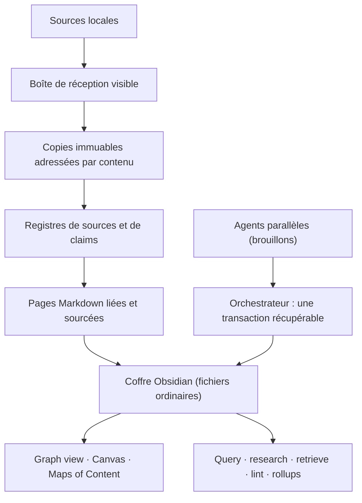

# AgriciDaniel/claude-obsidian

> Local knowledge system for Claude Code that feeds and queries a sourced Obsidian vault.

## The problem
AI note-taking workflows stop at the saved text: the source disappears, and nothing says whether a claim is supported.
Three months later, the vault is a pile of unlinked notes that nobody ever queries again.

## What it actually does
A four-step loop: capture the source through a visible inbox while keeping immutable, content-addressed copies; anchor each claim in source and claim ledgers (authority, freshness, support, contradiction, confidence, review state); link everything into pages, indexes, Maps of Content and Obsidian Canvas views; then query the vault again.
The vault remains an ordinary directory of Markdown, JSON and source files — not a plugin cache, not a cloud database.
Parallel agents cannot step on each other: workers return drafts, and a single orchestrator inspects and applies a recoverable transaction.
Every mutating configuration command previews its exact operation before it can be applied.

## How it is wired


## Trying it
```bash
git clone https://github.com/AgriciDaniel/claude-obsidian.git
cd claude-obsidian
# Le checkout contient le produit, ce n'est pas ton coffre :
# l'étape suivante initialise un coffre séparé (non lue ici, README tronqué).
```

## Cost and gotchas
Free and local by default: network egress is presented as an explicit, separate decision.
The real cost is that of the host agent's model calls, and the first setup requires a source checkout plus a separate user vault.

## What it is not
The README says so itself: not an automatic transcript recorder, not a cloud sync service, not a factual oracle.
Nor is it a substitute for backups or a version manager.
Optional adapters are detected and visibly degrade rather than being simulated — so some advertised capabilities may be missing on your setup.

## Alternatives
No competing repository is named in the portion of the README that was read.

## For you
Worth a look if you already keep an Obsidian vault and claim traceability matters; maturity and license remain to be checked before pouring your knowledge base into it.

---

## Production note

The source file `veille/.data/blocs/bloc-00.md` has 2,183 lines. Reading
stopped at line 830 (the harness's per-read token ceiling), i.e.
5 repositories out of 10, the fifth cut off in the middle of its README (`claude-obsidian`, step 2
of the quickstart).

The remaining 5 repositories were not read: no fiche was written for them
rather than inventing their content, rule 1 of the PLAN forbidding any
claim not traceable to the README.

To get them: rerun a block with `offset=831` on the same file.
