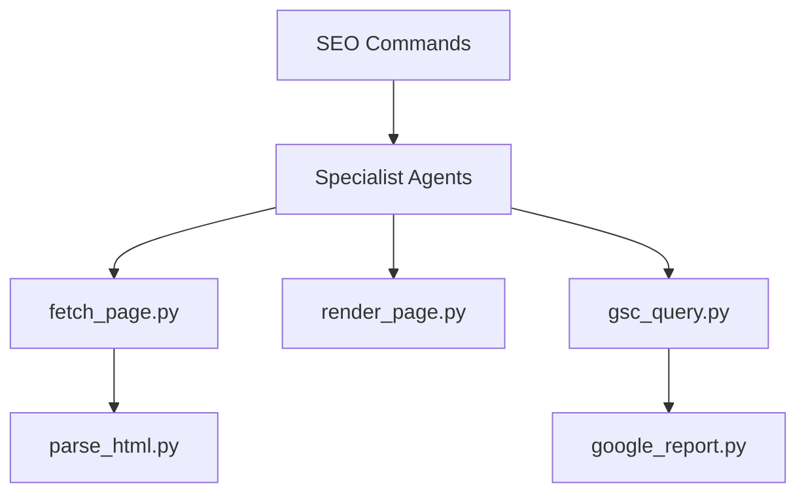

# AgriciDaniel/claude-seo

> Claude Code plugin that runs SEO audits in parallel with 18 specialized agents.

## The problem
A full SEO audit (technical, E-E-A-T, schema, AI search, local) takes hours and varies from one analyst to another.

## What it actually does
It provides 25 sub-skills, 18 agents and 32 `/seo` commands (`audit`, `page`, `schema`, `geo`…).
Rendering goes through Playwright Chromium and HTML analysis through trafilatura. Results come out as Markdown and PDF reports.
Google APIs (PSI, CrUX, GSC, GA4) are optional, in tiers.
There are 8 MCP extensions: DataForSEO, Ahrefs, Firecrawl…

## How it is wired


## Trying it
```bash
/plugin marketplace add AgriciDaniel/claude-seo
/plugin install claude-seo@agricidaniel-claude-seo
/seo setup
/seo audit https://example.com
```

## Cost and gotchas
A Claude Code subscription is required. Since v2.3.1, five agents run on Opus, which makes an audit more expensive. The extensions require paid accounts.

## What it is not
Not a full crawler: the README says so itself, for that you need Screaming Frog. A private variant, with early-access features, is reserved for paying community members.

## Alternatives
The README names no alternative repository. It points to the Codex SEO port by the same author.

## For you
Ignore: SEO is outside your scope. Only its parallel sub-agent architecture deserves a glance.
