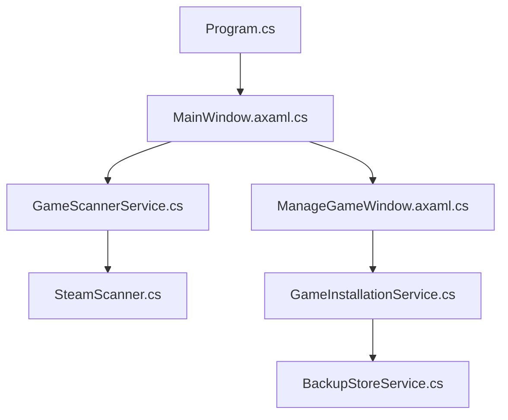

# Agustinm28/Optiscaler-Client

> Desktop application that installs and updates the OptiScaler mod across a whole game library.

## The problem
Installing OptiScaler (FSR, DLSS, XeSS upscaling) game by game, by hand, is repetitive.

## What it actually does
It detects games from Steam, Epic, GOG, EA, Ubisoft, Battle.net, Heroic and Xbox, downloads OptiScaler, Fakenvapi, NukemFG and FSR 4 DLLs, installs them by choosing the DLL injection method, backs up the original files so they can be restored, and manages INI profiles. Experimental mods are possible (AMD neural rendering, RTX 20/30 frame generation).

## How it is wired


## Trying it
```bash
git clone https://github.com/Optiscaler-Client/Optiscaler-Client.git
cd Optiscaler-Client
dotnet build
dotnet run
```

## Cost and gotchas
Free, self-contained binary (.NET included). The binary is not signed and some antivirus programs flag it; third-party DLLs (some via an unofficial mirror) are injected into games, at your own risk.

## What it is not
It is not an official OptiScaler project. It does not contain OptiScaler: it downloads it.

## Alternatives
No alternative named in the README.

## For you
Ignore: a video game tool, unrelated to your work.
