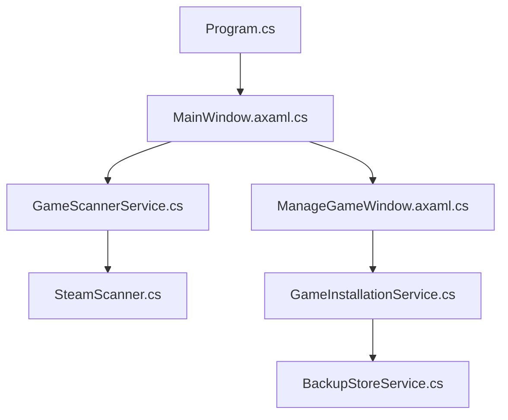

# Agustinm28/Optiscaler-Client

> Application de bureau qui installe et met à jour le mod OptiScaler dans toute une bibliothèque de jeux.

## Le problème
Installer OptiScaler (mise à l'échelle FSR, DLSS, XeSS) jeu par jeu, à la main, est répétitif.

## Ce que ça fait vraiment
Elle détecte les jeux Steam, Epic, GOG, EA, Ubisoft, Battle.net, Heroic et Xbox, télécharge OptiScaler, Fakenvapi, NukemFG et des DLL FSR 4, les installe en choisissant la méthode d'injection de DLL, sauvegarde les fichiers d'origine pour restaurer, et gère des profils INI. Mods expérimentaux possibles (rendu neuronal AMD, frame generation RTX 20/30).

## Comment c'est branché


## Essayer
```bash
git clone https://github.com/Optiscaler-Client/Optiscaler-Client.git
cd Optiscaler-Client
dotnet build
dotnet run
```

## Coût et pièges
Gratuit, binaire autonome (.NET inclus). Le binaire n'est pas signé et certains antivirus le signalent ; des DLL tierces (certaines via miroir non officiel) sont injectées dans les jeux, à tes risques.

## Ce que ce n'est pas
Ce n'est pas un projet officiel OptiScaler. Il ne contient pas OptiScaler : il le télécharge.

## Alternatives
Aucune alternative nommée dans le README.

## Pour toi
À ignorer : outil de jeu vidéo, sans lien avec ton métier.

