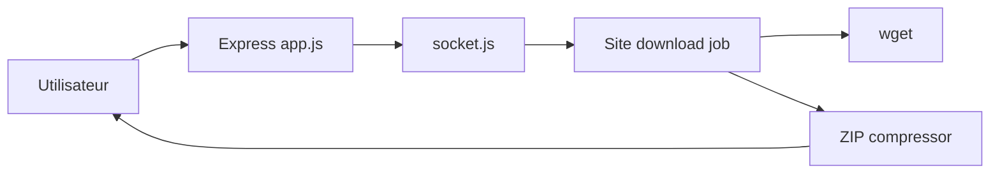

# AhmadIbrahiim/Website-downloader

> Small web app that downloads an entire site with wget and returns it as a ZIP.

## The problem
Retrieving a site's code and resources to browse it offline requires mastering wget's options.

## What it actually does
An Express app receives a URL through a web interface and a socket channel, runs `wget --mirror --convert-links --adjust-extension --page-requisites --no-parent`, compresses the result into a ZIP and sends it back. Variables: `PORT` (3000), `DOWNLOAD_QUOTA` (100m), `DOWNLOAD_TIMEOUT_MS` (300000). A public demo is mentioned.

## How it is wired


## Trying it
```bash
git clone https://github.com/AhmadIbrahiim/Website-downloader.git
cd Website-downloader
npm install
npm start
```

## Cost and gotchas
Free. Node.js 16+ and `wget` in the PATH are required. Default quota of 100 MB and timeout of 5 minutes. Protection against internal URLs: not documented.

## What it is not
Not a structured data collection tool: it is a mirror copy. It does not get around client-side rendered sites.

## Alternatives
No alternative named in the README.

## For you
Ignore: a one-line `wget --mirror` does the same thing, with no server to maintain.
