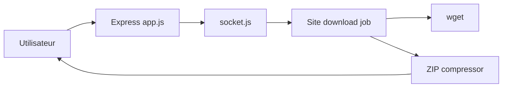

# AhmadIbrahiim/Website-downloader

> Petite appli web qui télécharge un site entier avec wget et le renvoie en ZIP.

## Le problème
Récupérer le code et les ressources d'un site pour le consulter hors ligne demande de maîtriser les options de wget.

## Ce que ça fait vraiment
Une appli Express reçoit une URL via une interface web et un canal socket, lance `wget --mirror --convert-links --adjust-extension --page-requisites --no-parent`, compresse le résultat en ZIP et le renvoie. Variables : `PORT` (3000), `DOWNLOAD_QUOTA` (100m), `DOWNLOAD_TIMEOUT_MS` (300000). Une démo publique est citée.

## Comment c'est branché


## Essayer
```bash
git clone https://github.com/AhmadIbrahiim/Website-downloader.git
cd Website-downloader
npm install
npm start
```

## Coût et pièges
Gratuit. Node.js 16+ et `wget` dans le PATH obligatoires. Quota de 100 Mo et délai de 5 minutes par défaut. Protection contre des URLs internes : non documentée.

## Ce que ce n'est pas
Pas un outil de collecte structurée de données : une copie miroir. Ne contourne pas les sites rendus côté client.

## Alternatives
Aucune alternative nommée dans le README.

## Pour toi
À ignorer : `wget --mirror` en une ligne fait la même chose, sans serveur à maintenir.

