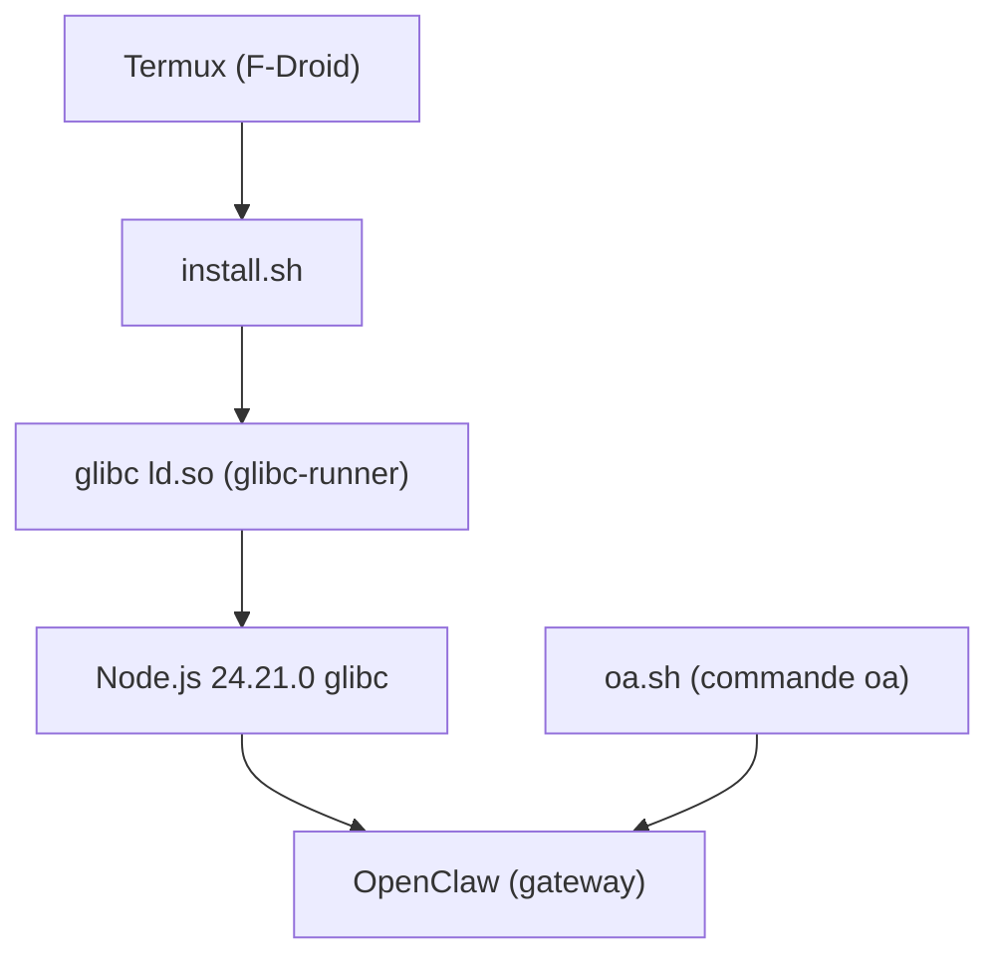

# AidanPark/openclaw-android

> Installer that runs the OpenClaw agent on Android inside Termux, without a full Linux distribution.

## The problem
Running OpenClaw on Android usually requires proot-distro and a Linux distribution, which is 700 MB to 1 GB of overhead.

## What it actually does
A script that installs the glibc linker and a wrapped glibc Node.js, fixes Linux paths to Termux ones, and installs OpenClaw at a pinned, verified version. The `oa` command handles update, backup and restore. A standalone Android app with a terminal is also offered. Optional tools can be added: tmux, code-server, OpenCode, Claude Code, Gemini CLI, Codex CLI.

## How it is wired
Simplified diagram based on the sheet, no diagram provided.



## Trying it
```bash
pkg upgrade -y && pkg install -y curl
curl -sL https://myopenclawhub.com/install | bash && source ~/.bashrc
openclaw onboard
openclaw gateway
oa --update && source ~/.bashrc
```

## Cost and gotchas
OpenClaw mostly routes to cloud APIs at your expense. About 2 GB of space is needed, and Termux from F-Droid. The README has you run a remote script via `curl | bash`: read it first.

## What it is not
Not a way to run local models: local inference on a phone is untested. Not OpenClaw itself, the version is pinned by this project.

## Alternatives
- proot-distro with a Linux distribution in Termux: the standard approach, heavier.

## For you
Ignore for a data / AI / MLOps profile: an agent on a phone adds nothing to your work, and installing through a remote script calls for caution.
