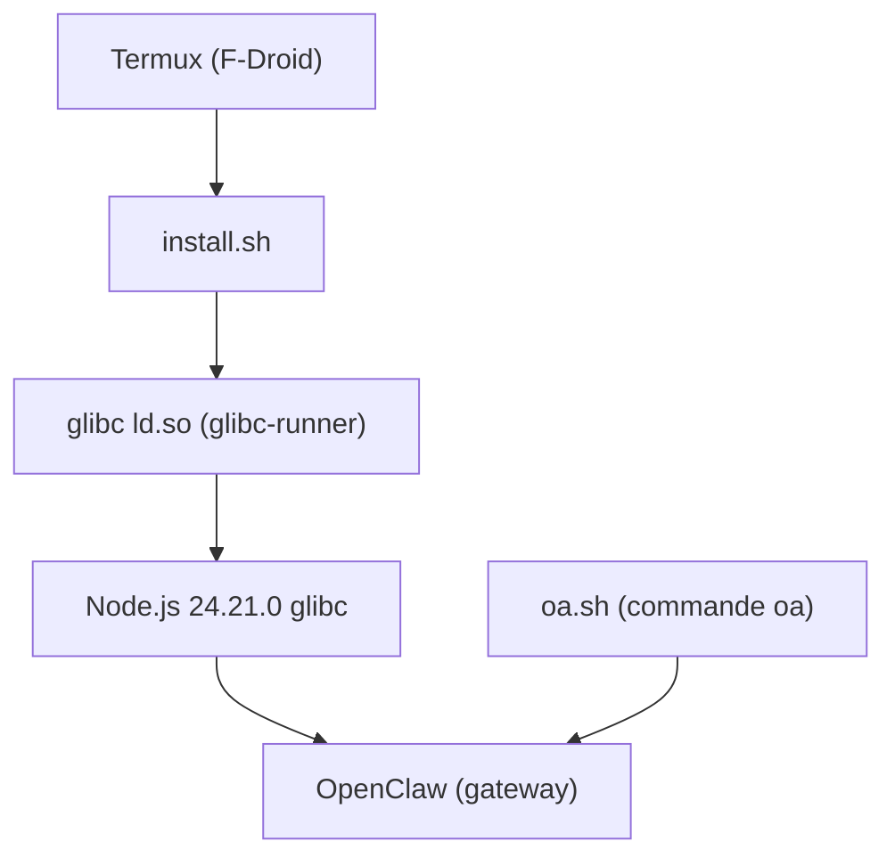

# AidanPark/openclaw-android

> Installateur qui fait tourner l'agent OpenClaw sur Android dans Termux, sans distribution Linux complète.

## Le problème
Faire tourner OpenClaw sur Android demande habituellement proot-distro et une distribution Linux, soit 700 Mo à 1 Go de surcoût.

## Ce que ça fait vraiment
Un script qui installe l'éditeur de liens glibc et un Node.js glibc enveloppé, corrige les chemins Linux vers ceux de Termux et installe OpenClaw à une version figée et vérifiée. La commande `oa` gère mise à jour, sauvegarde et restauration. Une application Android autonome avec terminal est aussi proposée. Des outils optionnels s'ajoutent : tmux, code-server, OpenCode, Claude Code, Gemini CLI, Codex CLI.

## Comment c'est branché
Schéma simplifié d'après la fiche, sans diagramme fourni.



## Essayer
```bash
pkg upgrade -y && pkg install -y curl
curl -sL https://myopenclawhub.com/install | bash && source ~/.bashrc
openclaw onboard
openclaw gateway
oa --update && source ~/.bashrc
```

## Coût et pièges
OpenClaw route surtout vers des API cloud à ta charge. Il faut environ 2 Go d'espace et Termux depuis F-Droid. Le README te fait exécuter un script distant par `curl | bash` : relis-le d'abord.

## Ce que ce n'est pas
Ce n'est pas un moyen d'exécuter des modèles locaux : l'inférence locale sur téléphone n'est pas testée. Ce n'est pas OpenClaw lui-même, la version est figée par ce projet.

## Alternatives
- proot-distro avec une distribution Linux dans Termux : approche standard, plus lourde.

## Pour toi
À ignorer pour un profil data / IA / MLOps : un agent sur téléphone n'apporte rien à ton travail, et l'installation par script distant demande de la prudence.

