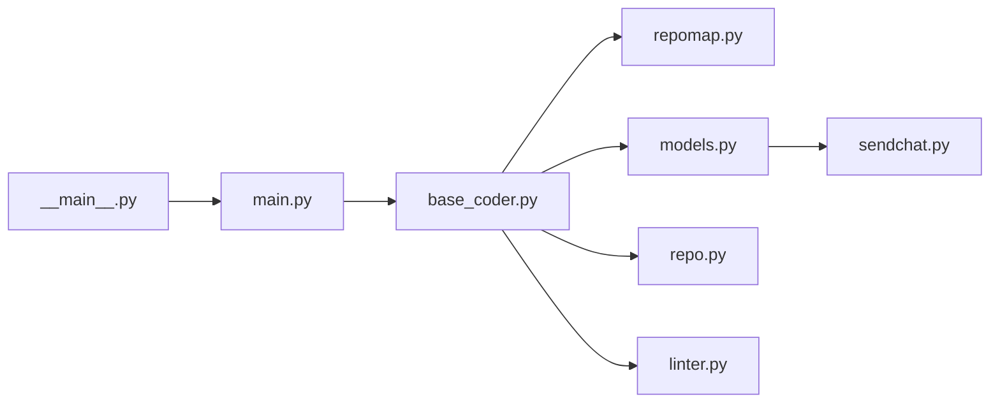

# Aider-AI/aider

> A terminal-based programming assistant that edits your Git repository using an LLM, for developers.

## The problem
Copying and pasting code between an LLM chatbot and its editor will lose the context of the project and the Git history.

## What it actually does
Creates a map of the repository (`repomap.py`, Tree-sitter) to provide context for the model.
Several editing protocols (block, unified diff, architect/editor) are available in `aider/coders/`.
Applies the changes, commits automatically, runs lint and tests, and re-injects errors.
Cloud or local models; image, URL, and voice inputs; watch mode for the IDE.

## How it is wired


## Trying it
```bash
python -m pip install aider-install
aider-install
cd /to/your/project
aider --model sonnet --api-key anthropic=<key>
```

## Cost and gotchas
The LLM vendor's invoice is your responsibility. There is an `analytics.py` module (for telemetry, separate from the core functionality).

## What it is not
Not a multi-tasking, autonomous agent; the models mentioned in the README (Claude 3.7, o3-mini) are outdated.

## Alternatives
Not documented.

## For you
Suitable for assisted editing in a terminal environment, but compare it to existing command-line agents before adopting it.
