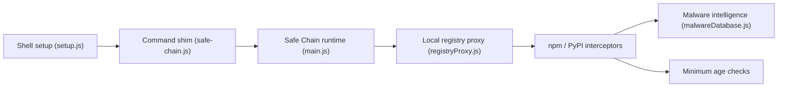

# AikidoSec/safe-chain

> A local proxy that blocks malicious or too-recent npm and PyPI packages on workstations and CI.

## The problem
An `npm install` or `pip install` can pull a booby-trapped or freshly published package before it is detected.

## What it actually does
Installs aliases (or shims in CI) around npm, yarn, pnpm, bun, pip, uv, poetry, pipx, pdm. Every download goes through a local proxy that checks the Aikido Intel threat list and enforces a minimum package age (48 h by default). Configurable by flag, environment variable or file; the list can be mirrored.

## How it is wired


## Trying it
```bash
curl -fsSL https://github.com/AikidoSec/safe-chain/releases/download/1.5.20/install-safe-chain.sh -o /tmp/install-safe-chain.sh
sh /tmp/install-safe-chain.sh
npm safe-chain-verify
npm install safe-chain-test
```

## Cost and gotchas
Free, no token; you need to restart the terminal. The proxy does a local MITM: `PIP_CONFIG_FILE` must be set to keep your pip config.

## What it is not
Not a total guarantee: it depends on the Aikido threat list (an external service); the extended protection (Maven, Go, extensions...) belongs to the paid Device Protection product.

## Alternatives
- Aikido Device Protection: extended, centralized version from the same vendor.

## For you
Adopt: low-cost protection of the Python/npm supply chain on workstations and CI, to be validated after checking the license.
