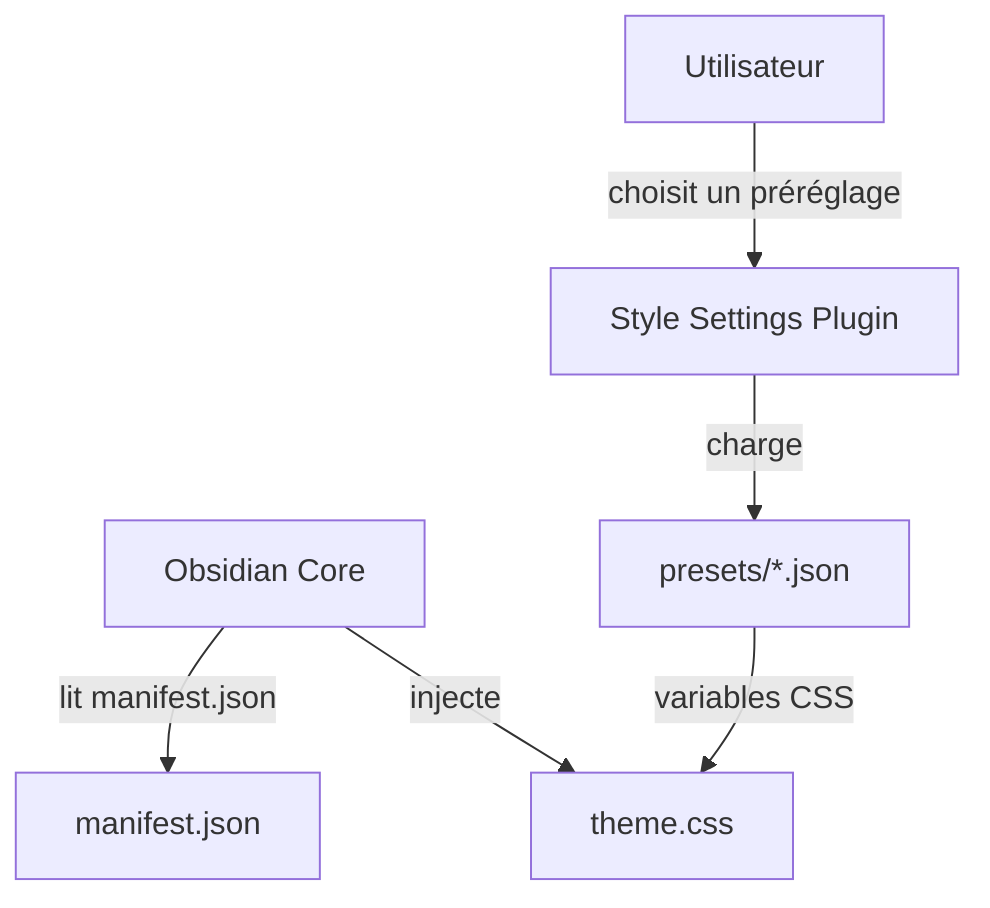

# Akifyss/obsidian-border

> Obsidian theme with borders, highly adjustable through the Style Settings plugin: for Obsidian users.

## The problem
Obsidian's default theme is hard to customize. It lacks card layouts and a hideable tab bar.

## What it actually does
Provides a `theme.css`, a `manifest.json` and JSON presets (Boundary, Neumorphism, Translucent, Sunset, Borderless...). Handles auto-hiding, card layout, a hover indicator, alternative checkboxes and callouts. Settings go through the Style Settings plugin.

## How it is wired

## Trying it
No command: the README says to copy a preset's code from its link, paste it into Style Settings, then restart Obsidian.

## Cost and gotchas
Free. Style Settings is recommended to get the most out of the theme. The "translucent window" option is not supported on Windows and Linux.

## What it is not
Not a functional plugin: only CSS and JSON, with no logic. It borrows ideas from the Maple, Minimal and Mado Miniflow themes.

## Alternatives
The README cites as inspirations: Maple by subframe7536, Minimal by kepano, Mado Miniflow by hydescarf.

## For you
Keep an eye on it: useful if you take notes in Obsidian and want a polished look, with no direct relation to data / AI work.
