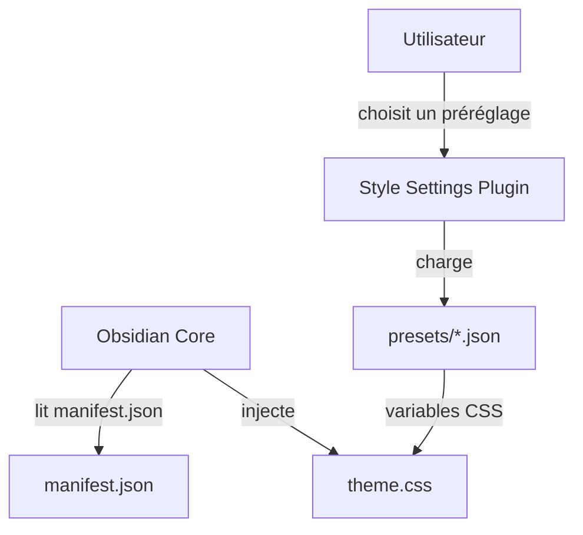

# Akifyss/obsidian-border

> Thème Obsidian à bordures, très réglable via le plugin Style Settings : pour les utilisateurs d'Obsidian.

## Le problème
Le thème par défaut d'Obsidian est peu personnalisable. Il manque des mises en page en cartes et une barre d'onglets masquable.

## Ce que ça fait vraiment
Fournit un `theme.css`, un `manifest.json` et des préréglages JSON (Boundary, Neumorphism, Translucent, Sunset, Borderless...). Gère masquage automatique, disposition en cartes, indicateur de survol, cases à cocher et callouts alternatifs. Les réglages passent par le plugin Style Settings.

## Comment c'est branché

## Essayer
Aucune commande : le README indique de copier le code d'un préréglage depuis son lien, de le coller dans Style Settings, puis de redémarrer Obsidian.

## Coût et pièges
Gratuit. Style Settings est recommandé pour profiter du thème. L'option « translucent window » n'est pas prise en charge sous Windows et Linux.

## Ce que ce n'est pas
Pas un plugin fonctionnel : uniquement du CSS et du JSON, sans logique. Il reprend des idées des thèmes Maple, Minimal et Mado Miniflow.

## Alternatives
Le README cite comme inspirations : Maple de subframe7536, Minimal de kepano, Mado Miniflow de hydescarf.

## Pour toi
À surveiller : utile si tu prends des notes sous Obsidian et veux un rendu soigné, sans rapport direct avec le travail data / IA.

