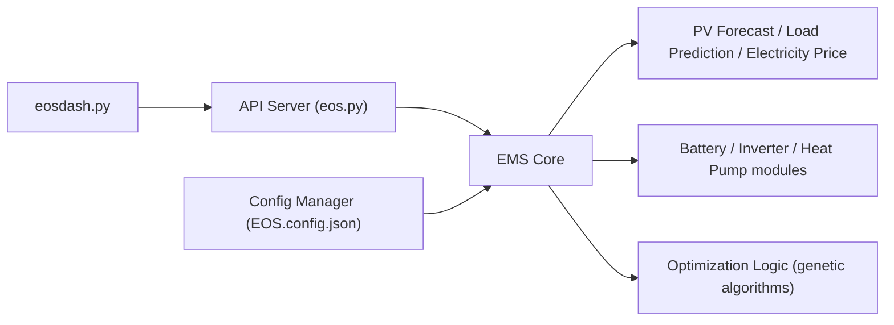

# Akkudoktor-EOS/EOS

> Home energy simulation and optimization engine (PV, battery, EV) to plug into a home automation system.

## The problem
Minimizing grid consumption and maximizing resale requires planning battery, vehicle and loads according to forecasts and prices.

## What it actually does
FastAPI server (API on 8503, EOSdash dashboard on 8504) that forecasts PV production, load and electricity prices, then optimizes with a genetic algorithm a plan for battery, inverter, EV and loads. Configuration via `EOS.config.json`. It does not control any equipment: you must integrate it with Home Assistant, Node-RED or EVCC.

## How it is wired


## Trying it
```bash
docker pull akkudoktor/eos:latest
docker compose up -d
git clone https://github.com/Akkudoktor-EOS/EOS.git
python -m venv .venv
.venv/bin/pip install -r requirements.txt
.venv/bin/python -m akkudoktoreos.server.eos
```

## Cost and gotchas
Free; Docker or Python 3.11+. The next (unreleased) version changes the API: `POST /v1/optimize` has a different format, devices have stable IDs and incomplete forecasts can stop a run.

## What it is not
It is not a controller: without home automation and without configuration, it does nothing concrete. License to be checked (not identified by GitHub).

## Alternatives
No alternative named in the README.

## For you
Worth watching: a well-delimited optimization and forecasting case, useful only if you have a PV/battery installation and home automation.
