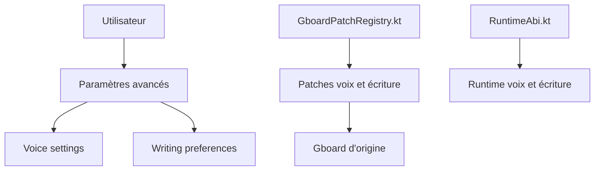

# Akshayykadam/PixelBoard

> Modified Gboard without root, with Gemini voice dictation and an AI writing assistant, for Android users.

## The problem
The dictation and AI writing features of the Pixel keyboard are not available on other Android phones.

## What it actually does
- Signed APK that installs alongside Gboard under the identifier `com.akshaykadam.pixelboard`.
- "Rambler" dictation that removes hesitations and adds punctuation.
- Proofreading, rewording and tone change via Gboard's server.
- Camera text scanning, extended clipboard history, built-in update.

## How it is wired


## Trying it
```bash
adb install -r PixelBoard-1.3.5.apk
adb shell am force-stop com.akshaykadam.pixelboard
```

## Cost and gotchas
Free, but the patch only works on Gboard 18.6.3.100. On-device AI exists only on Pixel; elsewhere, requests go through Google's servers. Project not affiliated with Google.

## What it is not
Not an independent keyboard: it is a patch of a Google binary, with no guarantee and a risk of breakage with every version.

## Alternatives
No alternative named in the README.

## For you
Ignore: mobile keyboard modification, outside the data, AI or MLOps scope, and fragile against Gboard updates.
