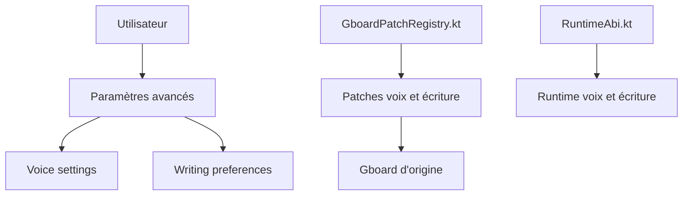

# Akshayykadam/PixelBoard

> Gboard modifié sans root, avec dictée vocale Gemini et assistant d'écriture IA, pour utilisateurs Android.

## Le problème
Les fonctions de dictée et d'écriture IA du clavier des Pixel ne sont pas disponibles sur les autres téléphones Android.

## Ce que ça fait vraiment
- APK signé qui s'installe à côté de Gboard sous l'identifiant `com.akshaykadam.pixelboard`.
- Dictée « Rambler » qui retire les hésitations et ponctue.
- Correction, reformulation et changement de ton via le serveur de Gboard.
- Scan de texte par caméra, historique du presse-papiers étendu, mise à jour intégrée.

## Comment c'est branché


## Essayer
```bash
adb install -r PixelBoard-1.3.5.apk
adb shell am force-stop com.akshaykadam.pixelboard
```

## Coût et pièges
Gratuit, mais le correctif ne marche que sur Gboard 18.6.3.100. L'IA locale n'existe que sur Pixel ; ailleurs, les requêtes passent par les serveurs Google. Projet non affilié à Google.

## Ce que ce n'est pas
Pas un clavier indépendant : c'est un patch d'un binaire Google, sans garantie, avec risque de rupture à chaque version.

## Alternatives
Aucune alternative nommée dans le README.

## Pour toi
À ignorer : modification de clavier mobile, hors du périmètre data, IA ou MLOps, et fragile face aux mises à jour de Gboard.

