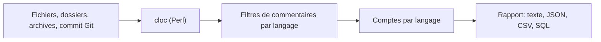

# AlDanial/cloc

> Counts blank lines, comment lines and source code in many languages, for developers and code auditors.

## The problem
Measuring the size of a codebase (by language, by archive or by commit) without writing your own analyzer.

## What it actually does
A single Perl script, with no dependency beyond the standard distribution, that counts lines of code, comment lines and blank lines across files, folders, archives (tar, zip, whl, ipynb, rpm, deb) and Git commits. It compares two versions (--diff), adds up reports, outputs text, CSV, JSON, XML, YAML, Markdown or SQL, and recognizes hundreds of languages. Documented limit: mixed code+comment lines count as code, and comment markers inside strings can skew the count.

## How it is wired


## Trying it
```bash
cloc hello.c
cloc gcc-5.2.0/gcc/c
cloc master.zip
cloc --vcs git
docker run --rm -v $PWD:/tmp aldanial/cloc .
```

## Cost and gotchas
Free. Perl required for the source version; the Windows executable needs nothing. No Linux/macOS binary. --diff is slow on large files, and --processes does not work on Windows. Distribution packages are not controlled by the author.

## What it is not
Not a syntax parser: it parses no language and remains approximate. Embedded languages (JS in HTML) are counted as the host file's language.

## Alternatives
The README cites scc, tokei, loc, gocloc, Ohcount, SLOCCount, among others.

## For you
Adopt: a simple command-line tool to size a repository or a notebook, with usable JSON/CSV output; GPL-2.0 license has no impact for command-line use.
