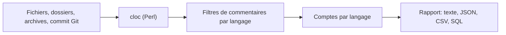

# AlDanial/cloc

> Compte lignes vides, commentaires et code source dans de nombreux langages, pour développeurs et auditeurs de code.

## Le problème
Mesurer la taille d'un code (par langage, par archive ou par commit) sans écrire son propre analyseur.

## Ce que ça fait vraiment
Un seul script Perl, sans dépendance hors distribution standard, qui compte les lignes de code, de commentaires et les lignes vides sur fichiers, dossiers, archives (tar, zip, whl, ipynb, rpm, deb) et commits Git. Il compare deux versions (--diff), additionne des rapports, sort du texte, CSV, JSON, XML, YAML, Markdown ou SQL, et reconnaît des centaines de langages. Limite documentée : les lignes mixtes code+commentaire comptent comme code, et les marqueurs de commentaire dans des chaînes peuvent fausser le décompte.

## Comment c'est branché


## Essayer
```bash
cloc hello.c
cloc gcc-5.2.0/gcc/c
cloc master.zip
cloc --vcs git
docker run --rm -v $PWD:/tmp aldanial/cloc .
```

## Coût et pièges
Gratuit. Perl requis pour la version source ; l'exécutable Windows n'a besoin de rien. Pas de binaire Linux/macOS. --diff est lent sur gros fichiers, et --processes ne marche pas sous Windows. Les paquets des distributions ne sont pas contrôlés par l'auteur.

## Ce que ce n'est pas
Pas un analyseur syntaxique : il ne parse aucun langage et reste approximatif. Les langages embarqués (JS dans du HTML) sont comptés comme le langage du fichier hôte.

## Alternatives
Le README cite scc, tokei, loc, gocloc, Ohcount, SLOCCount, entre autres.

## Pour toi
À adopter : outil de ligne de commande simple pour chiffrer la taille d'un dépôt ou d'un notebook, sortie JSON/CSV exploitable ; licence GPL-2.0 sans incidence pour un usage en ligne de commande.

