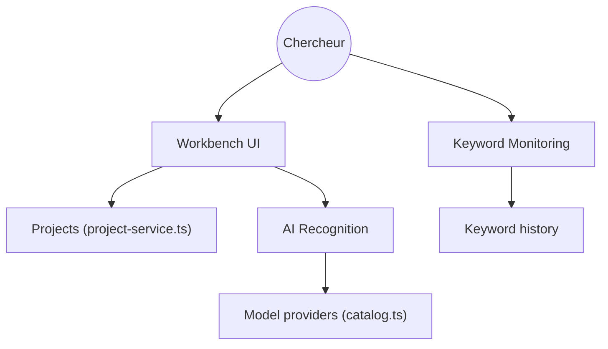

# Albert-Weasker/niubigeo

> Self-hosted tool that compares what AI models say about a product, to track its visibility.

## The problem
GEO dashboards (visibility in AI answers) give an opaque score, without the original answer behind it.

## What it actually does
You enter a domain, the tool queries several models via OpenRouter or direct APIs, then stores answers, cited competitors, sources and history. A keyword monitoring module schedules measurements and compares two runs (Diff View). It observes the providers' APIs, not the chat interfaces.

## How it is wired


## Trying it
```bash
git clone --branch v0.3.3 --depth 1 https://github.com/Albert-Weasker/niubigeo.git
cd niubigeo
npm ci
cp .env.example .env
npm run server
```

## Cost and gotchas
Node.js 22.13+ and an OpenRouter key (`OPENROUTER_API_KEY`); each test bills models and search. Prompts are sent to external APIs. An optional link to an external video advisor can be disabled.

## What it is not
Not a search engine rank tracker. Not a measure of real audience: an answer is not a permanent ranking.

## Alternatives
Profound, Peec AI, Otterly.AI, Semrush AI Visibility, Ahrefs Brand Radar: hosted commercial services, more complete for marketing.

## For you
Ignore: a GEO marketing tool, unrelated to data / AI / MLOps work, and still in beta.
