# Albert-Weasker/niubigeo

> Outil auto-hébergé qui compare ce que des modèles d'IA disent d'un produit, pour suivre sa visibilité.

## Le problème
Les tableaux de bord GEO (visibilité dans les réponses d'IA) donnent un score opaque, sans la réponse d'origine derrière.

## Ce que ça fait vraiment
Tu saisis un domaine, l'outil interroge plusieurs modèles via OpenRouter ou des API directes, puis stocke réponses, concurrents cités, sources et historique. Un module de suivi par mots-clés planifie des mesures et compare deux exécutions (Diff View). Il observe les API des fournisseurs, pas les interfaces de chat.

## Comment c'est branché

```mermaid
flowchart TD
  U(("Chercheur")) --> W["Workbench UI"]
  W --> P["Projects (project-service.ts)"]
  W --> R["AI Recognition"]
  R --> M["Model providers (catalog.ts)"]
  U --> K["Keyword Monitoring"]
  K --> H["Keyword history"]
```


## Essayer
```bash
git clone --branch v0.3.3 --depth 1 https://github.com/Albert-Weasker/niubigeo.git
cd niubigeo
npm ci
cp .env.example .env
npm run server
```

## Coût et pièges
Node.js 22.13+ et clé OpenRouter (`OPENROUTER_API_KEY`) ; chaque test facture modèles et recherche. Les prompts partent vers les API externes. Un lien optionnel vers un conseiller vidéo externe est désactivable.

## Ce que ce n'est pas
Pas un suivi de rang de moteur de recherche. Pas une mesure d'une audience réelle : une réponse n'est pas un classement permanent.

## Alternatives
Profound, Peec AI, Otterly.AI, Semrush AI Visibility, Ahrefs Brand Radar : services commerciaux hébergés, plus complets en marketing.

## Pour toi
Ignorer : outil de marketing GEO, sans lien avec le travail data / IA / MLOps, et encore en bêta.

